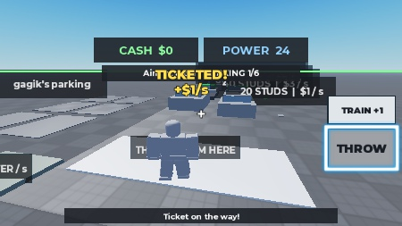
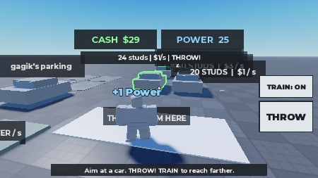
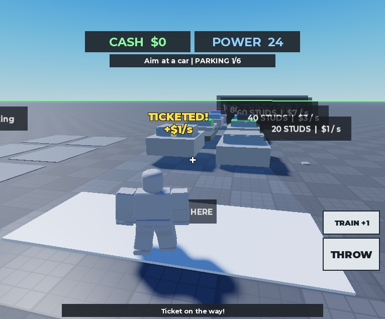

# Iteracja 2 — kamera i game feel — 02.11.2026
Status: IMPLEMENTED; testy techniczne opisane niżej VERIFIED w podanym zakresie. Wygląd/balans: NOT FINAL.

## Przyczyna i naprawa kamery
- Odtworzono: CameraType=Scriptable mimo ustawienia Custom; po 0,2 s wracał Scriptable.
- Winny: TicketCamera na Camera+1, wymuszenie CFrame/Scriptable w każdej klatce i własny input bez zoomu.
- Usunięto przejęcie i ręczną obsługę obrotu. PlayerModule obsługuje Classic/Custom, Humanoid, orbit i zoom 0,5–64.
- Lekki Humanoid.CameraOffset=(2,25;1,25;0) odsuwa postać od celownika; nie przejmuje obrotu ani zoomu.
- HUD nie ma aktywnego pełnoekranowego tła. Brak własnych blokad ContextActionService.

## Celowanie i autorytet
- Celownik używa dokładnie ViewportSize/2, bez błędu górnego paska GUI.
- Klient wysyła położenie i kierunek promienia środka kamery; nigdy id trafionego auta ani kwoty.
- Serwer sprawdza typy, wartości skończone, długość kierunku, położenie kamery, cooldown, linię startową, zasięg, łuk i slot.
- Serwer sam wybiera auto na promieniu; obsługa myszy i THROW używa tej samej funkcji.
- Zysk +$X/s oznacza przyszły dochód; Cash nadal rośnie wyłącznie po dostawie na serwerze.

## Testy
| Próba | Wynik |
| --- | --- |
| Telefon poziomo, iPhone 7, 666×374 | PASS: Custom/Humanoid, obrót dotykiem. Końcowy look (-.205,-.258,-.944)→(-.010,-.048,-.999). |
| Zoom w emulatorze telefonu | PASS: 12,5→7,92 przez przewijanie; fizyczny gest pinch pozostaje nieweryfikowany. |
| Środek ekranu | PASS: celownik (333,187) = ViewportSize/2. |
| Postać tyłem do celu | PASS: postać +Z, kamera w stronę -Z, trafienie auta przed kamerą. |
| GUI telefonu | PASS: rzeczywiste Activated przycisków THROW i TRAIN przez wybór GUI i Return; tapnięcia MCP były nieprecyzyjne. Nie nazywamy tego testem fizycznego palca. |
| HUD telefonu | Cash/Power po 22 px, THROW 110×62, TRAIN 110×44; 8 px przerwy do przycisku skoku, celownik odsłonięty. |
| PC, 766×635 | PASS: Custom/Humanoid, koło myszy 12,5→5,264, klik (100,280) wybiera cel przy środku, nie przy kursorze. |
| Obrót RMB/myszą PC | NEEDS VERIFICATION: RMB przełącza MouseBehavior na LockCurrentPosition, ale MCP daje Delta=(0,0); nie udało się zweryfikować rzeczywistego ruchu myszy. |
| Computer Use jako drugi sposób | Dwie próby capture/odświeżenia: FrameArrived/window capture timeout. Przerwano tę metodę, bez zmiany kamery pod ograniczenie narzędzia. |
| Lot i trafienie | PASS: łuk i obrót, StuckTicket, TICKETED! +$1/s, lokalny bounce oraz dźwięk. Bez payoff po pudle. |
| Podskok tylko klienta | Zarejestrowane lokalne Y=2,541 przy bazowym 1,75; serwer widział Y=1,75. |
| Laweta i parking | 2 równoległe lawety; hook obecny. Sekwencja z lotem: 2,53–2,57 s. ParkingPop skala od 0,01 do 1 z krótkim overshoot 1,099. |
| Trening | Naturalne 24→44, zielone auto odblokowane; ekranowe +1 Power po zmianie atrybutu. |
| Regresja klient/serwer | 14/14 PASS, tests/ClientScenarios.luau: odmowy, 2 lawety, 6 miejsc/dostaw, income=10, Cash rośnie, pełny parking, NaN/infinity/zły origin/spam nic nie przyznają. |
| Sprzątanie | PASS: po animacjach 0 dzieci w folderze FX i 0 popupów; kamera nadal Custom. |
| Test reguł | 15/15 PASS (10 istniejących + 5 iteracji 2): optyczny środek, poprawny origin, NaN, za daleki origin, budżet ≤3 s. |
| Końcowy smoke po przesunięciu nad ramię | PASS: telefon — obrót/zoom, GUI THROW/TRAIN, trafienie/+1; PC — klik z boku trafia centralne auto, zoom. |
| Konsola końcowych Play | Klient errors=[], serwer errors=[]; brak serwerowego folderu TicketClientFX. |

## Efekty i źródła
- Wszystkie ozdobniki są w kliencie: Effects.luau; stan i transport wciąż na serwerze.
- Dźwięk: wbudowany rbxasset://sounds/volume_slider.ogg, preloaded (IsLoaded=true), bez uploadu i zewnętrznego id.
- LihFolk Vault V2, CC BY 4.0: Camera Systems; Game Feel and Juice; Replicating VFX; Sound Fundamentals; World-Space UI.
- LihFolk opisuje pomijanie AlwaysOnTop BillboardGui przez automatyczny capture; popupy zastąpiono czytelnym ScreenGui śledzącym punkt świata.
- Jedna próbka istniejącego HUD i jednego auta z szybą; bez nowych stref, sklepu, petów, Rebirth, zapisu i publikacji.
- Pierwsza regresja zatrzymała się w kodzie testu: próbowała wybrać auto przed jego odrodzeniem. Poprawiono czas oczekiwania testu; pełny powtórzony przebieg 14/14, bez błędów.

## Co pozostało
- Rzeczywisty obrót RMB/myszą oraz pinch na fizycznym telefonie, multiplayer i ocena zabawy przez ludzi.
- Dalekie etykiety stref nachodzą na siebie; wygląd tej próbki i balans NOT FINAL.
- Rojo build i porównanie 7 źródeł; po pracy Edit, emulator i tymczasowy HTTP wyłączone.

## Test użytkownika — 2 minuty
1. Play: PC prawy przycisk + mysz / telefon przeciągnięcie; zoom kółkiem / szczypnięciem.
2. Z białej linii naprowadź środek na bliskie auto. THROW; PC także klik z boku widoku.
3. Obserwuj TICKETED!, mandat na szybie i dostawę; rzuć ponownie zanim laweta wróci.
4. TRAIN: +1 Power i odblokowanie zielonego auta po ok. 20 s. Stop/Play zeruje sesję.

