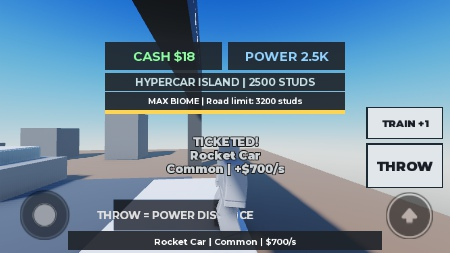
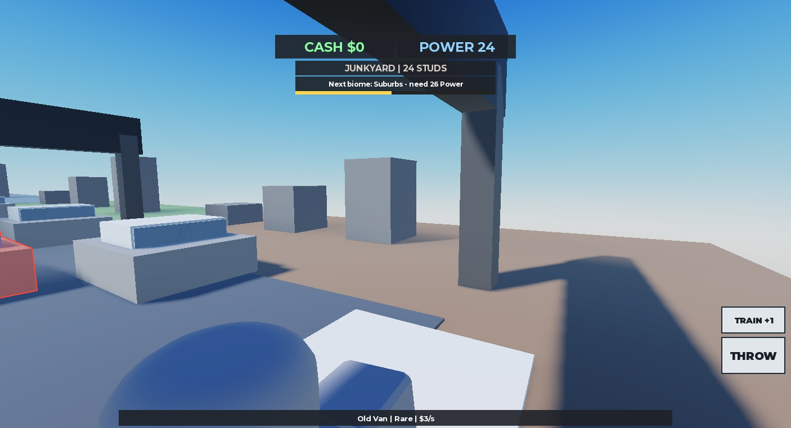
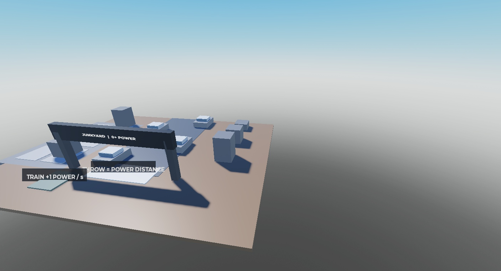

# Iteracja 3 — raport końcowy, 02.11.2026
Status: VERIFIED — Studio, emulator iPhone 7 poziomo + PC, jeden gracz. Wznowiono i zakończono po przerwie użytkownika.
Wygląd i balans: NOT FINAL. Gra nie była publikowana.

## Wykonano
- Zapisano zatwierdzoną decyzję: rzut bez celowania, odległość=Power, pula według biomu.
- Użytkownik zaakceptował próbkę Junkyard; ten układ zastosowano do sześciu biomów.
- Usunięto Aim i celownik; THROW nie ma argumentów. Serwer odrzuca dodatkowe dane.
- Config zawiera 6 progów, nazwy, pule, wagi, dochody, czasy, limit mapy i cenę sprzedaży.
- Domyślne wagi 70/22/7/1; dochód biom × rzadkość. Ceny i progi do balansu.
- Po zapełnieniu parkingu: wymiana najsłabszego lub jednorazowa sprzedaż.
- Stare auto zarabia do przyjazdu nowego; token miejsca odrzuca spóźnioną starszą dostawę.
- Kolorowe podłoża, szare dekoracje, 6 bram i po 4 auta widokowe.
- Najbliższy napis bramy, chowany przy kolizji z HUD; ostatnie SurfaceGui ustawiono jako pasywne.
- Dalekie wyniki mają serwerowe metadane i lokalny podgląd niezależny od wczytania modelu.
- Kamera nie jest przejmowana przez rzut.

## Wykonane testy
- Telefon poziomo iPhone 7: 666×374. PC: 1406×761.
- 14/14 scenariuszy serwera PASS; 7 podstawowych + 29 nowych asercji PASS.
- Granice 0,24,49,50,149,150,399,400,999,1000,2499,2500 i ponad koniec mapy.
- Dokładna pozycja lądowania = Power; clamp do 3200; auto zawsze z właściwej puli.
- 6 aut na parkingu, 6 poprawnych wymian, dochód aktywnych aut zgodny z serwerem.
- Słabszy wynik sprzedany dokładnie raz; test $10 i zachowany income.
- Burst 30 próśb → jeden przyjęty rzut. Argumenty power/car/rarity/NaN/infinity odrzucone.
- Rzeczywiste losowania dały 3 rzadkości; 47 pakietów klienta miało metadane, kamera pozostawała Custom.
- Symulacja 10 000 losowań (seed 20261102): Common 6989, Rare 2218, Epic 692, Legendary 101.
- Obserwowano 3 lawety jednocześnie, odrodzenie 24 aut widokowych i transport ok. 2,55 s.
- Objazd 6 bram: poprawny wybór najbliższej, maksymalnie jeden napis; później dodano dodatkowe ukrywanie pod HUD.
- Phone Power 24 → Junkyard/Old Van; Power 2500 → Hypercar Island/Hypercar.
- Potwierdzony Epic Broken Pickup w fioletowym kolorze i kwota sprzedaży $80.
- PC Power 50 → Suburbs/Hatchback, lądowanie Z=-50; zoom 12,5→5,26.
- W przebiegu automatycznym logi klienta i serwera były bez błędów; wcześniejsze błędy dotyczyły komend diagnostycznych, nie pętli gry.

## Końcowy smoke po wznowieniu
- Wszystkie 6 źródeł w Studio identyczne z src; aktualny Rojo build zakończony poprawnie.
- Ponownie wykonano 7+29 asercji: 36/36 PASS.
- Telefon: VirtualInput wygenerował prawdziwe zdarzenia Touch; 12 kroków po (8,-2) zmieniło kierunek kamery o 96°. CameraType Custom.
- Telefon: przycisk THROW, rzut przy Power 24, następnie przy Power 2500 → biom 6, lądowanie Z=-2500 mimo obróconej kamery.
- Telefon: przycisk TRAIN włącza/wyłącza trening; Power 2500→2501. HUD mieści się w 666×374; SurfaceGui pasywne.
- Po drugim dostarczeniu: 2 auta, dochód 701/s, transport 2,57 s, Cash rośnie.
- PC: RMB blokuje kursor w LockCurrentPosition, SendMouseDelta obraca kamerę o 59,57°; po zwolnieniu Default. Zoom 12,50→3,80.
- PC: klik w świat rzucił na 24 study, biom 1; maksymalnie jeden napis bramy; HUD pozostaje czytelny.
- Logi PC klient/serwer bez błędów; serwer telefonu bez błędów. Jedyny błąd klienta telefonu pochodził z diagnostyki: VirtualInput odrzucił klik w nakładkę CoreGui CaptureControls. Klik lewej części TRAIN przeszedł; nie zmieniano gry pod narzędzie.
- Dowody: `2026-11-02_iteration3_final_smoke.json`; wcześniejsze scenariusze w `2026-11-02_iteration3_evidence.json`.

## Ograniczenia i zabawa
- Fizyczny telefon i multiplayer nieprzetestowane. Testy techniczne nie potwierdzają oceny zabawy.
- Najsłabszy punkt: bierne czekanie na Power; przy +1/s Hypercar Island wymaga około 41 minut od startu. Balans NOT FINAL.
- Cash nie ma jeszcze zastosowania; dalsza metagra poza zakresem tej iteracji.

## Zrzuty

## Zapis
- assets/SavedStudio_2026-11-02.rbxlx: pełny lokalny plik miejsca, aktualna mapa Studio + aktualne źródła Rojo.
- assets/StudioMapSnapshot_2026-11-02.rbxm: eksport mapy bezpośrednio SerializationService.
- assets/Prototype.rbxlx: standardowy build kodu i generatora.
- Duże pliki poza gitem. reports/2026-11-02_iteration3_evidence.json zawiera wyniki testów.
- Po zatrzymaniu testów Studio pozostaje w Edit; emulator i tymczasowy HTTP wyłączone.
- Źródła wiedzy: LihFolk Vault V2 (CC BY 4.0), Secure Remotes, RNG/Collection, Zone and Biome Art Direction, Version History and Backups.
