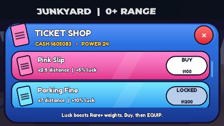
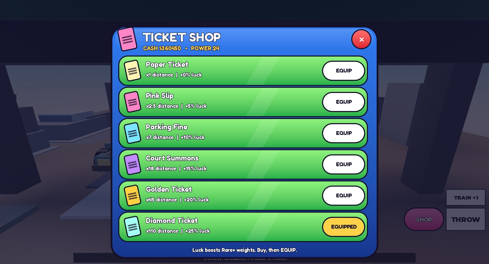
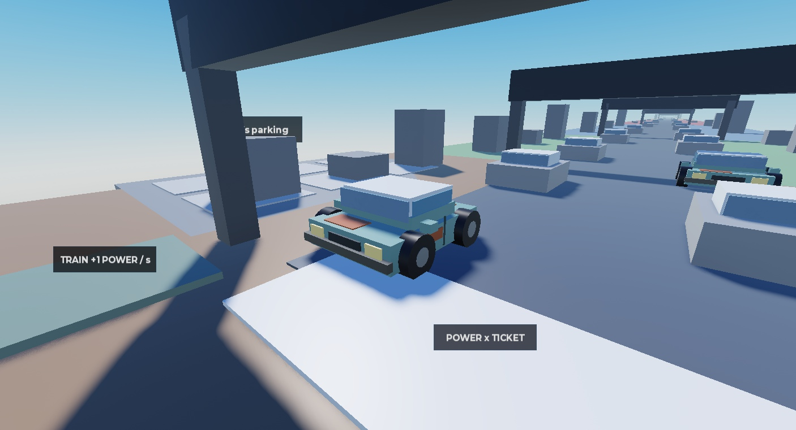
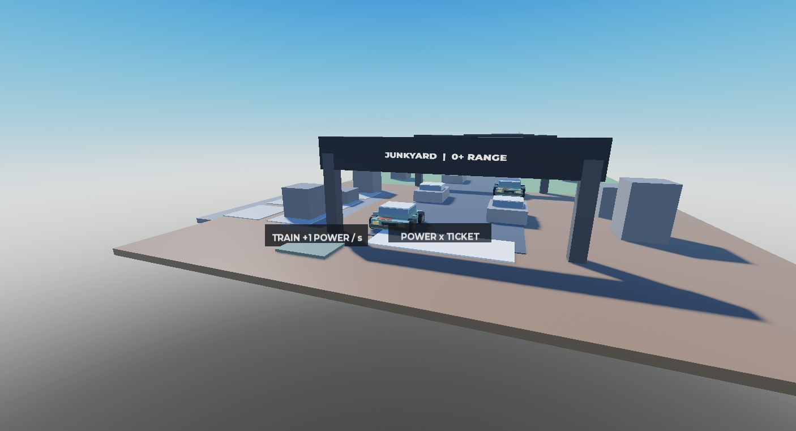

# Iteracja 4 — sklep, zapis i Rusty Sedan, 02.11.2026
Status: VERIFIED — funkcje w Studio, emulator iPhone 7 poziomo + PC, jeden gracz.
Sklep i próbka auta: NOT FINAL. Balans NOT FINAL. Brak publikacji, Robux i uploadów.

## Wykonano
- 6 mandatów w Config: nazwy/ceny/mnożniki/luck; cena 0/100/1200/12000/90000/600000.
- Mnożniki x1/2,5/7/18/45/110. Power 24 daje dystanse 24/60/168/432/1080/2640, po jednym biomie na typ.
- Bonus luck 0/5/10/15/20/25% mnoży tylko wagi Rare+, następnie normalizacja; nie oznacza punktów procentowych.
- BUY sprawdza profil, typ argumentów, Cash, własność i poprzedni mandat; EQUIP tylko posiadany. Rate limit serwera.
- Okno jest jedyną próbką UI w stylu D: niebieski gradient, Fredoka One, okrągłe ramki, stany kart, BUY/EQUIP/EQUIPPED/LOCKED, czerwony X.
- SHOP przy kciuku pulsuje, gdy stać na następny mandat; ograniczony ruch wyłącza puls skali.
- Telefon: lista przewijana, przy otwarciu pokazuje następny zakup w całości. PC: sześć wierszy bez przewijania.
- Tylko Rusty Sedan: 29 prostych części, 0 MeshPart/tekstur/skryptów w modelu, koła/szyby/zderzaki/rdza, bez marek.
- Przeszukano Models/Kits/CATALOG.csv LihFolk Asset Pack: brak auta/sedana/pojazdu; wykonano dozwolony fallback z części.
- Pozostałe auta pozostały szarymi klockami. Powtórzenia Rusty Sedan to ten sam jeden projekt, nie kolejne modele.

## Zapis i odporność
- Jeden writer Profiles: UpdateAsync, lease 90 s, token sesji, kopia snapshotu, sekwencyjne zapisy i bounded retry/backoff.
- Schema 1 i whitelist: Cash, Power, Owned, Equipped, Parking (Slot/Biome/Rarity/Name). Income odtwarzany z katalogu.
- Autosave 25 s, rozłożony w czasie; czysty profil odnawia lease do 30 s. Niepilne zapisy sprawdzają budżet.
- Zakup/equip uruchamia zapis wkrótce (debounce, min. 8 s odstępu). Wyjście i shutdown zwalniają lease.
- Shutdown czeka także na rozpoczęte loady i ich anulowanie/release; poprawka po niezależnym przeglądzie kodu.
- Failed/locked/future/corrupt load nie daje profilu do gry i nie nadpisuje danych domyślnymi.
- Pending auto jest częścią obiecanego parkingu; odtwarzane jako zaparkowane. Sprzedaż dopisuje Cash przed kosmetyczną lawetą, dokładnie raz.
- Studio: osobny magazyn ThrowTicketsAtCars_v1_STUDIO, tymczasowe klucze QA. Live: ThrowTicketsAtCars_v1.
- Użytkownik włączył API Services po odmowie sondy. Nie ma pamięciowego zamiennika udającego trwały zapis.
- Po testach TestProfileKey usunięty. Brak zmian w magazynie live. Bez dochodu offline.

## Testy
- RED: test Pink Slip początkowo zwrócił błąd, bo dystans nadal wynosił 24. Po implementacji PASS.
- 72/72 asercje: 7 bazowych, 29 biomów, 27 ticket/shop/schema, 9 ochrony profilu.
- Wstrzyknięty magazyn: drugi writer zablokowany, failed load nie zapisuje, przyszły schemat nietknięty, fence odrzuca stary token, niejednoznaczny release jest idempotentny, cancel po claim zwalnia lease.
- Telefon 666×374: brak Cash → odmowa; BUY Pink ($100) → Own_pink; EQUIP → 24×2,5=60, biom Suburbs, auto dostarczone.
- Telefon: SHOP! i AffordableHint po osiągnięciu ceny następnego; X zamyka okno. Akcja 118×52 px, następny zakup cały w widoku.
- PC 1406×761: BUY/EQUIP Parking Fine, Power 37 → 259, Downtown. Dodatkowo Diamond przy Power 24 → 2640, Hypercar Island.
- Odrzucenia: pominięcie kolejności, ponowny zakup, unowned equip, NaN/id typu table/długi id/dodatkowy argument/zła akcja.
- 40 próśb o Court Summons: jeden zakup, Cash 1000000→988000. Kolejny zakup: Already owned.
- Rzeczywisty API save/Stop/Play: Cash co najmniej 777, Power 37, Paper+Pink, Equipped pink i Hatchback w slocie 1 wróciły.
- Kolejny rejoin: wszystkie 6 mandatów, Equipped diamond, Power 24, 3 auta i income 725/s; Cash 360450 (rośnie o income).
- 14/14 regresji serwera: 6 miejsc, najsłabsze podmieniane, dawny dochód podczas lawety, sprzedaż raz, progi biomów, clamp, cooldown, malformed requests, respawn 24 aut, dochód.
- 47 eventów z metadanymi, maks. 3 lawety naraz, maks. 1 napis bramy, kamera cały czas Custom; transport 2,58 s.
- Końcowe logi klient/serwer: 0 MessageError gry. Wcześniejsze odrzucenia VirtualInput były komendami QA; Studio zgłasza też warning pluginu/avatara 203785492.
- Rojo build PASS; 10/10 źródeł Studio identycznych z folderem. Oddzielny przegląd statyczny nie znalazł dalszych istotnych błędów po poprawce zamykania.
- Dowody maszynowe: 2026-11-02_iteration4_evidence.json.

## Próbki do oceny

## Ograniczenia / następny krok
- Wygląd sklepu i auta czeka na ocenę użytkownika; nie robiono dalszych modeli ani innych okien.
- Ceny, mnożniki i tempo do dalszych zakupów wymagają testu zabawy; techniczny PASS ich nie zatwierdza.
- Fizyczny telefon, multiplayer i prawdziwa awaria backendu niebadane; błędy/wyścigi danych testowano przez wstrzyknięty magazyn.
- Awaria serwera/backendu może pozostawić lease do 90 s lub cofnąć niezapisany odcinek; nie ma obietnicy bezwarunkowego zapisu.

## Zapis lokalny i źródła
- assets/SavedStudio_2026-11-02.rbxlx: aktualne 10 źródeł + mapa z SerializationService; plik poza gitem.
- assets/StudioMapSnapshot_2026-11-02.rbxm oraz standardowy assets/Prototype.rbxlx; kod źródłem prawdy.
- Test API wykonuj w otwartym powiązanym miejscu 74773184167716, lokalna kopia nie publikuje gry.
- Studio Edit, emulator/HTTP wyłączone. Brak publikacji.
- Wiedza: LihFolk Vault V2 (CC BY 4.0), DataStore Safety, Session Locking, Saving Correctly, RNG Drops and Luck, UI Builder; playbook gry.
