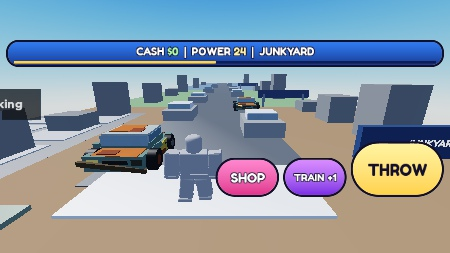
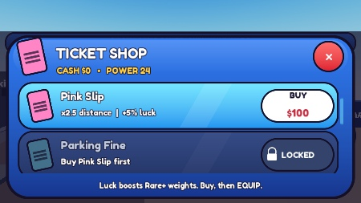
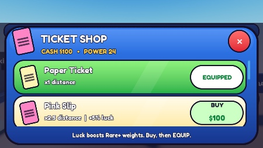
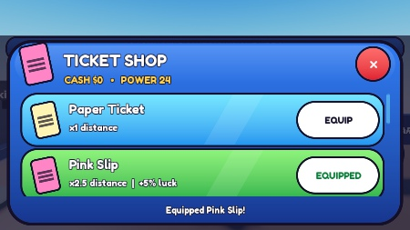
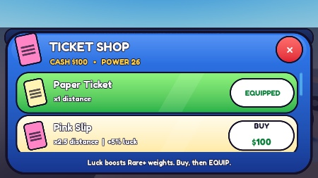
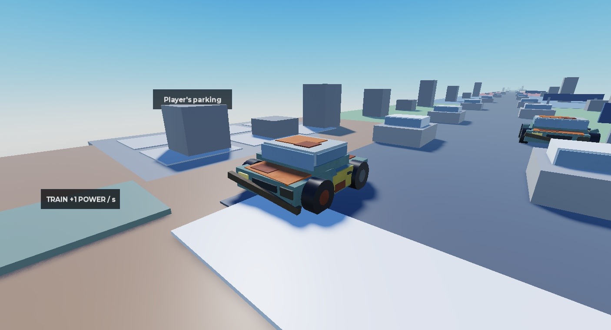
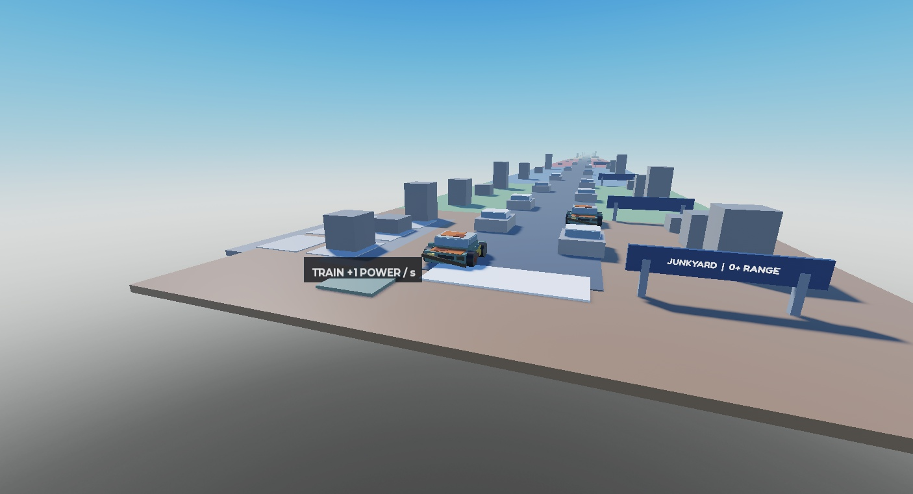

# Iteracja 4b — poprawki próbek, 02.11.2026
Status: VERIFIED — techniczne testy UI w emulatorze iPhone 7 poziomo, 666×374, jeden gracz.
Sklep/HUD/Rusty Sedan v2 i balans: NOT FINAL, oczekują oceny użytkownika.

## Zmiany
- Jedna reguła kolorów: EQUIPPED zielony; owned niewyposażony normalny niebieski; dostępny zakup jasny; brak Cash normalny; zablokowany ciemny.
- Affordable BUY pulsuje biały/jasnozielony. Puls koloru działa niezależnie od animacji naciskania.
- Cena na BUY 22 px: zielona przy pokryciu, czerwona przy braku środków. Ukryte +0% luck.
- Kłódka z prostych elementów UI i warunek Buy <previous ticket> first. Brak nowych assetów.
- HUD w stylu D: jedna linia Cash | Power | biome, pod nią 4-pikselowy pasek; wspólny moduł Style dla sklepu i HUD.
- Górny pasek ma 34 px; z marginesem i obrysem 41/374 px = 10,96% wysokości telefonu.
- SHOP 88×52, TRAIN 88×52, THROW 132×76; kolejność od lewej, odstępy 12 px, wspólna dolna linia.
- Komunikat na dole pojawia się tylko po zdarzeniu. Kamera nadal Custom.
- Usunięte bramy nad drogą; niskie tablice na prawym poboczu, najwyższa krawędź 6 studów.
- Usunięty środkowy napis na linii rzutu. Ze startu widoczne kolejne kolory biomów i prosta droga.
- Rusty Sedan v2: duże brązowe/pomarańczowe plamy na masce/dachu/bagażniku, żółte drzwi, cofnięty/skręcony błotnik, krzywy zderzak (-10°), ciemny reflektor i matowa powierzchnia.
- 36 prostych części, 0 meshes, 0 uploadów. To nadal jeden projekt Rusty Sedan; inne auta pozostają szare.
- Ekonomia, zakupy i zapis korzystają z serwera iteracji 4; brak migracji danych.

## Test
- 65 asercji UI w trzech przebiegach (22 + 22 + 21): stany wyprowadzone z faktycznych atrybutów własności i gotówki.
- Potwierdzone: equipped / owned / affordable / unaffordable / locked, zielony tylko equipped, cena i kłódka/warunek, brak +0 luck.
- Zmiana Cash z braku środków do 1200 zmieniła wiersz i cenę; rzeczywisty kolor BUY pulsował, np. (0,995;1;0,995)→(0,827;1;0,804).
- BUY Parking Fine → Owned, EQUIP → Equipped, poprzedni Pink Slip → Owned; puls zakupionego mandatu wyłączony.
- Wszystkie badane cele dotykowe ≥44×44; THROW największy. Brak nakładania trzech przycisków; 12 px przerwy.
- Statystyki mieszczą się w jednej linii. Cały górny HUD poniżej 12% wysokości.
- TRAIN dodał +1 Power i wyłączył się po drugim kliknięciu. THROW przy Pink trafił na 67,5 studa; transport 2,57 s.
- Po zamknięciu sklepu przeciągnięcie Touch obróciło kamerę o 25,34°. Tryb Custom.
- Wszystkie tablice poza szerokością drogi; raycast środkiem drogi na wysokości 3 studów wolny do 500 studów.
- Końcowy przebieg: 0 MessageError klienta i serwera. Wcześniejsze błędy komend diagnostycznych (niedostępny PlayerModule / nawigacja) nie są raportowane jako błędy gry.
- Rojo build PASS. Lokalna kopia miejsca obejmuje aktualne 12 źródeł i mapę.
- Dowody: 2026-11-02_iteration4b_evidence.json; powtarzalna kontrola: tests/iteration4b.client.luau.

## Powtórna weryfikacja po ponowieniu zlecenia, 02.11.2026
- Potwierdzono 12/12 skryptów Studio zgodnych z folderem; poprawki z commit d32d82e były już obecne.
- Świeży, osobny profil QA: 68 kontroli UI (23+23+22), wszystkie PASS. Postęp użytkownika pozostawiono z jego ostatniej sesji.
- BUY/EQUIP Pink: Cash 100→0, Power 24, dystans 60. Kolor BUY pulsuje przy pokryciu, po zakupie puls gaśnie.
- Wszystkie cztery wymagane stany oraz owned potwierdzone; po zamknięciu sklepu kamera obraca się o 38,57°, Custom.
- Rusty Sedan v2: 36 części, Concrete, inne drzwi, zderzak -10°. Końcowe logi klient/serwer bez MessageError.
- Cztery główne zrzuty telefonu poniżej odświeżono z nowego przebiegu; pozostałe zdjęcia pokazują tę samą próbkę 4b.
- Wyniki dopisano do sekcji recheck w pliku evidence.json. Wygląd nadal NOT FINAL.

## Zrzuty do oceny

## Ograniczenia i następny krok
- Test dotyczył UI i próbek. Emulator generował ruch postaci także przed kliknięciami UI; do pomiarów/zrzutów ustawiono nieruchomą postać QA. Swobodny ruch i fizyczny telefon wymagają osobnej kontroli.
- Nie powtarzano całego testu backendu zapisu: ta warstwa nie była zmieniana, poprzednia weryfikacja w raporcie iteracji 4.
- Wygląd i czytelność z daleka czekają na ocenę użytkownika. Nie wykonywano innych modeli ani publikacji.
- Po testach: Studio Edit, emulator i HTTP wyłączone, klucz QA usunięty; runtime unieruchomienie postaci nie trafia do źródeł/zapisu.
- Kopia lokalna assets/SavedStudio_2026-11-02.rbxlx i StudioMapSnapshot_2026-11-02.rbxm; źródłem prawdy src/.
- Wiedza/styl: LihFolk Vault V2 (CC BY 4.0), UI Builder oraz playbook/UI_STYLE i MOBILE_UI.
