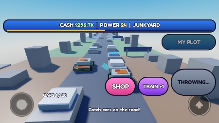
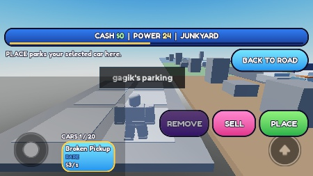
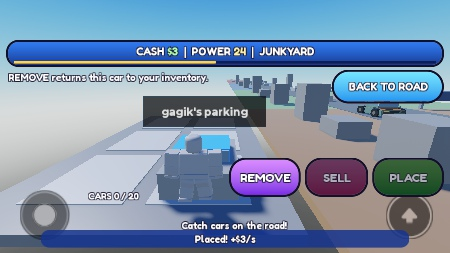
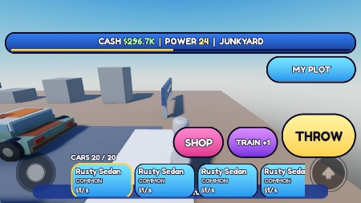
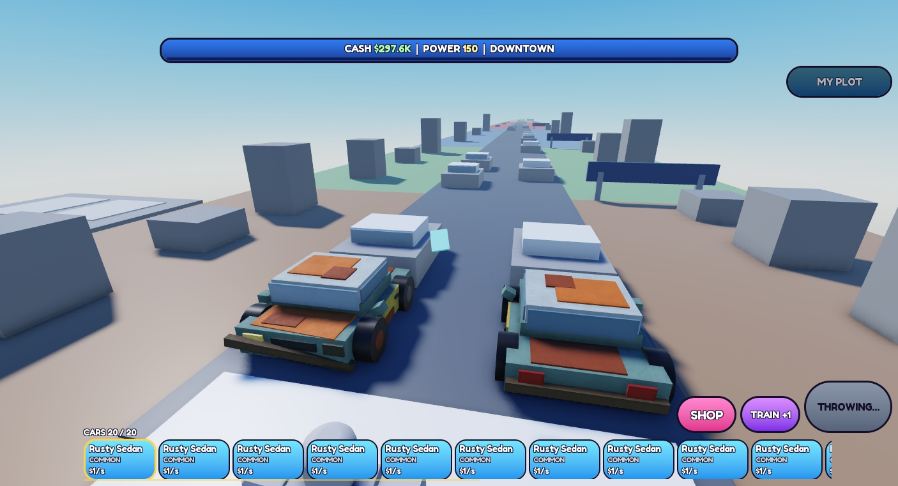
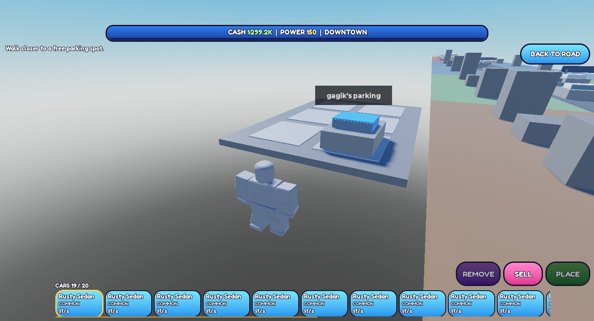

# Iteracja 6 — pełna pętla rzutu
02.11.2026 · VERIFIED w opisanym zakresie Studio · wygląd i balans NOT FINAL.

## Przyczyna „x2.5 distance”
W folderze, gicie (wszystkie dostępne gałęzie) i Studio była nadal iteracja 4b. Nie znaleziono implementacji, commitu ani raportu iteracji 5. Config.Tickets zawierał Multiplier, Rules.distance mnożyło Power, a Shop wyświetlał „x%g distance”. To był działający stary system, nie sam stary napis lub cache synchronizacji. Usunięto mnożniki mandatów w każdym z tych miejsc. Rarity.Multiplier pozostaje wyłącznie mnożnikiem dochodu auta.

## Co działa
- Zasięg = min(Power, koniec mapy), mandaty tylko luck. TRAIN uruchamia ćwiczenie ramion; +1/s wyłącznie przy aktywnym treningu. Stanie na płytce nie daje Power.
- Stan serwera obejmuje przygotowanie, zamach, lot i lawetę. Przycisk THROW wyszarzony. Zatwierdzony łup jest zapisany przed uruchomieniem animacji.
- Zamach 0,45 s + obracający się mandat lecący łukiem 2 s; kamera śledzi i wraca do standardowego Roblox. Wynik serwera wjeżdża pasem dokładnie w miejsce trafienia.
- TICKETED!, nazwa i kolor rarity, naklejka na szybie, dźwięk; laweta 0,5+0,2+1,3 s; teleport na własną działkę.
- Auta pokazowe jeżdżą bez fizyki, klient aktualizuje widoczne pasy 30 Hz. Daleki wynik ma lokalny podgląd tego samego typu, gdy model nie jest jeszcze zreplikowany.
- Hotbar, wybranie auta, PLACE przy wolnym własnym miejscu, REMOVE, SELL lub zostawienie w ekwipunku. Dochód tylko za auta postawione.
- 20 miejsc w ekwipunku + 6 na działce, liczone na serwerze. MY PLOT pozwala wrócić i zwolnić miejsce bez rzutu; BACK TO ROAD wraca na linię startową.
- Schema 2: Cars z trwałym ID i Slot. Migracja zachowuje stary parking, Cash, Power i mandaty. Lease/token, autosave/leave/shutdown i osobny magazyn Studio zachowane.
- Nadal jeden model-próbka Rusty Sedan v2. Nowy hotbar to jedna próbka, niezatwierdzona wizualnie przez użytkownika.

## Testy
Studio MCP, jeden gracz. Najpierw telefon poziomo 666×374, potem PC 1406×761. QA korzystał z osobnego klucza; postępu użytkownika nie resetowano. Do powtarzalnych klików/zrzutów stabilizowano postać w czasie testu.

| Próba | Wynik |
| --- | --- |
| Reguły i migracja | 62 asercje PASS: 6 mandatów bez zasięgu, wszystkie progi biomów, ruch pasa, limit mapy, migracja, limity, własność, transakcje |
| Profile / podstawy | 9 + 7 asercji PASS; razem 78. Magazyn testowy symuluje m.in. błąd i utratę potwierdzenia zapisu |
| Telefon: THROW + 30 żądań | Dokładnie jeden zaakceptowany rzut; blokada i wyszarzenie widoczne |
| Paper i Diamond przy Power 24 | Oba lecą 24, Junkyard; Diamond pokazuje +25% luck, brak mnożnika dystansu |
| Lot / transport | Wynik jedzie, trafienie, laweta, teleport. Całość po akceptacji zmierzona 4,43–4,47 s; lot z zamachem 2,45 s, laweta 2 s |
| Trening | Włączenie przyciskiem, zmiana pozy stawów, +1 Power; zatrzymany trening / samo stanie bez przyrostu |
| PLACE / REMOVE | Income 0→3→0/s; zmiana własności slotu i liczby aut. Cash rośnie tylko po postawieniu |
| SELL / powtórka | Rare income3 sprzedane za $30; ponowna sprzedaż tego ID nie daje pieniędzy |
| Pełny ekwipunek | 20 + 1 postawione; kolejny grant odrzucony; REMOVE nie niszczy postawionego auta; spam THROW nie daje wyniku |
| Powrót przy pełnym | MY PLOT działa; sprzedaż zwalnia miejsce, potem REMOVE i PLACE ponownie działają |
| Save/rejoin 1 | Te same 20 ID/typów/rarity/slotów, Power24, Diamond, 19 w ekwipunku + 1 postawione |
| PC: Power150 + spam | Jeden rzut, dystans150, Downtown, mimo Diamond. Police Cruiser Common income20 |
| Śmierć podczas lotu | Kamera wraca z Scriptable do Custom, po odrodzeniu śledzi nowy Humanoid; łup zachowany na działce |
| PC: obsługa złapanego auta | PLACE / REMOVE / wybór przewiniętej karty / SELL za $200; dochód wrócił z23 do3/s |
| Save/rejoin 2 | Dokładnie te same ID/typy/rarity/sloty; Power150, Diamond, 19 w ekwipunku + 1 postawione, income3 |
| Logi końcowe | Świeży przebieg klienta i serwera: 0 MessageError gry |

Wyniki maszynowe: [evidence.json](2026-11-02_iteration6_evidence.json). Scenariusze BUY/EQUIP nadal korzystają z walidowanego sklepu, a testy nie zmieniały bezpośrednio własności mandatów. Kontrolowany budżet i Power ustawiano wyłącznie narzędziem serwerowym dostępnym w Studio.

## Zrzuty
Telefon: rzut z zablokowanym THROW i kamerą.

Telefon: własna działka, wybrane auto i PLACE.

Telefon: auto po postawieniu.

Telefon: 20/20 w ekwipunku, możliwość MY PLOT.

PC: lot do Downtown przy Power150.

PC: działka i hotbar po końcowym rejoin.

## Ograniczenia i ocena pętli
- Fizyczny telefon, swobodny ruch na nim, wielu graczy i prawdziwa awaria DataStore nie były testowane. Przydzielanie oddzielnych działek jest zaimplementowane; potrzebny osobny test wieloosobowy.
- Przygotowanie rzutu czeka na trwały zapis łupu; wolny backend może dodać opóźnienie przed animacją. Nie mierzymy tego jako część 2,45 s zamachu/lotu.
- Wymuszone powroty droga↔działka po każdym aucie mogą być najbardziej męczącą częścią. Czas sekwencji i wygoda hotbara wymagają oceny zabawy przez użytkownika.
- Wygląd, ceny, tempo ćwiczeń i luck NOT FINAL. Brak publikacji, Robux, petów, Rebirth i kolejnych modeli.

## Stan przekazania
Folder i Studio mają 18 zgodnych źródeł. Build Rojo i pełna lokalna kopia assets/SavedStudio_2026-11-02.rbxlx. Studio pozostawione w Edit, emulator wyłączony, TestProfileKey usunięty, HTTP off. Przed migracją zachowano lokalną kopię profilu użytkownika w ignorowanym assets/.
