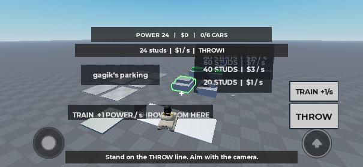
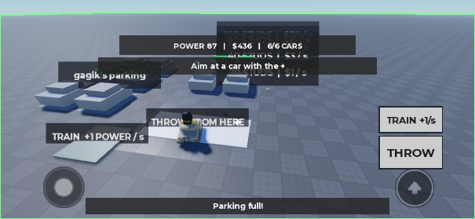
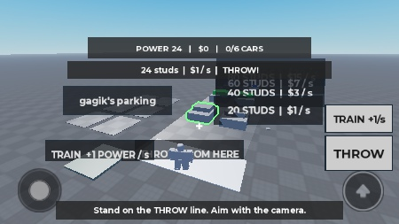
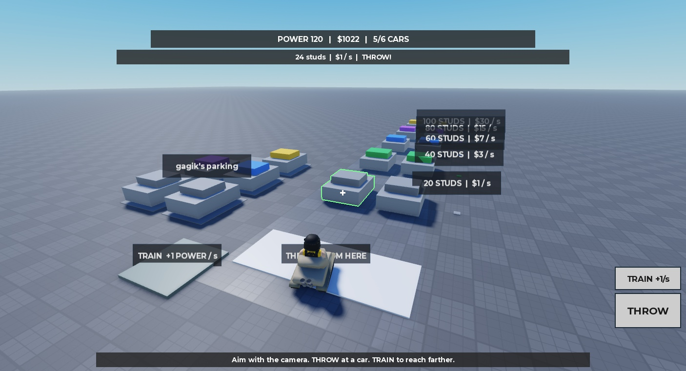
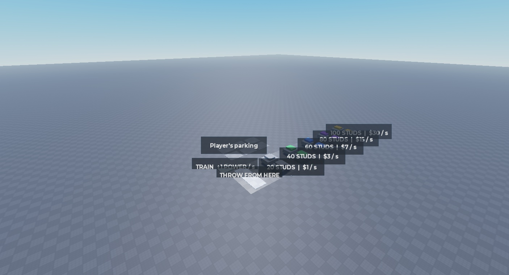

# Prototyp — 02.11.2026

Status: VERIFIED (test techniczny, jeden gracz). Wygląd i balans: NOT FINAL.
Test zabawy z ludźmi: NEEDS VERIFICATION. Nie publikowano gry.

## Środowisko i źródła
- Miejsce 74773184167716, Studio MCP; najpierw telefon poziomo, potem PC.
- iPhone 13 Pro: viewport 749×388, bezpieczny HUD 749×330.
- Mały iPhone 7: 666×374, bezpieczny HUD 666×316; THROW 110×56, TRAIN 110×44.
- PC: viewport 1406×761. Przyciski GUI oraz bezpośredni klik w auto.
- Rojo 7.7.1; kod z src/ → Rojo build → lokalny snapshot → Studio.
- Wszystkie 5 źródeł w Studio porównano znak w znak z wynikiem Rojo.
- Wiedza: LihFolk Vault V2 (CC BY 4.0), Secure Remotes, System Builder, Projectiles and Ballistics, worked build server-checked hits; playbook vaulta. Bez starych folderów i bez internetu.

## Wyniki
| Próba | Wynik i dowód |
| --- | --- |
| THROW na telefonie | PASS: fizyczne tapnięcie z MCP, ParkingUsed 0→1, czerwona obwódka, laweta; mały telefon także Delivered=1 i Cash=1. |
| Celowanie na telefonie | PASS: przeciągnięcie zmieniło kierunek kamery z (-.364,-.364,-.857) na (-.135,-.542,-.829). |
| Za daleko | PASS: moc 24 i strefa 40 → Too far! TRAIN for more power.; bez nowego auta. |
| Laweta w tle | PASS: drugi rzut po .8 s; w tym samym momencie 2 lawety i 2 rezerwacje. |
| Rezerwacje/dostawy | PASS: 6 miejsc zarezerwowanych, potem Delivered=6, Income=10. |
| Cash | PASS: rośnie po dostawie; w scenariuszu 6 aut: $106, później $436, income $10/s. |
| TRAIN | PASS: tapnięcie przycisku, rzeczywiste tyknięcia 24→44; następnie przyjęte zielone auto strefy 40. |
| Płytka | PASS: Training=false, TrainingActive=true, moc rosła; z TRAIN na płytce +4 w oknie 3.1 s (granica tyknięć), bez podwajania. |
| Łuk | PASS: po poprawce serwer sprawdza segmenty tego samego łuku co efekt klienta; dalszy cel przy odrodzonym bliskim aucie przyjęty. |
| Pełny parking | PASS: Parking full!, dalej 6 miejsc/6 dostaw, siódmy cel pozostaje dostępny. |
| Odrodzenie | PASS: nowe auta po odbiorze; wykorzystane ponownie w scenariuszu 6 miejsc. |
| Strefy 60/80/100 | PASS: serwerowo ustawiona moc QA=120 (nie udajemy treningu), wszystkie 3 trafienia i dostawy; income 54 z 5 aut. |
| PC | PASS: THROW z GUI, klik auta myszą (nie wywołanie remote), TRAIN zwiększył moc 24→26. |
| Poza linią rzutu | PASS: z płytki treningowej Stand on the THROW line!, brak auta. |
| Błędne dane i spam | PASS: NaN, infinity, Instance zamiast id, zerowy kierunek, za długi id, 30 żądań naraz; stan 6 aut bez zmian. |
| Reguły | PASS: 10 asercji (wartości skończone, zasięg, wolne miejsce, strefa rzutu, punkt łuku), świeża kopia modułu. |
| Końcowy smoke | PASS: najnowszy kod, neutralny awatar, mały telefon; Play → THROW → dostawa → Cash. |

## Co nie jest potwierdzone
- Nie było testu multiplayer ani fizycznego telefonu i testu z trzema ludźmi.
- Nie oceniamy wyglądu, balansu ani tego, czy gracz zechce zagrać ponownie.
- Etykiety stref nachodzą na siebie na telefonie; to ograniczenie tej szarej próbki.
- Cash nie ma zastosowania; po 6 autach sesja dochodzi do ślepej uliczki. Reset Stop/Play.
- Użytkownik nie zaakceptował jeszcze próbki mapy ani HUD.

## Konsola i poprawki
- Bieżący LogService: serverErrors=[] i clientErrors=[] w końcowym Play.
- get_console_output nadal zwraca historyczne Script injection failed i błąd awatara rbxassetid://203785492; brak tego assetu i kodu injection w src/. Nie utożsamiamy tego z błędami prototypu.
- Poprawiono startowy kadr nad autami: własna kamera z przeciąganiem na telefonie i prawym przyciskiem na PC.
- Poprawiono rozbieżność łuk efektu/prosta walidacji: współdzielony Rules.arcPoint i segmentowe sprawdzanie serwera.
- Neutralny awatar zamiast dodatków użytkownika; bez nowych modeli i assetów.

## Odtworzenie
1. Play, na białej linii celuj kamerą; THROW w szare auto i drugie po ok. sekundzie.
2. Obserwuj dwie lawety, parking i Cash. Włącz TRAIN na ok. 20 s.
3. Wyceluj w zielony dach; THROW. Zapełnij 6 miejsc, sprawdź Parking full!.
4. PC: także klik auta. Stop/Play resetuje stan; brak DataStore.
- Reguły: tests/rules.spec.luau; scenariusz klienta: tests/ClientScenarios.luau (tylko Studio, poza Rojo).
- Po testach: Edit z podglądem wygenerowanym z World; emulator wyłączony, HttpEnabled=false.

## Wniosek o zabawie (ocena Codexa, nie wynik playtestu)
Najlepszy czytelny moment: dwa mandaty i dwie lawety pracujące równocześnie. Najsłabszy: bierne TRAIN i czekanie na liczbę. Pełny parking szybko kończy wybory. Nie dokładamy systemów przed oceną użytkownika.

## Zrzuty

