# Iteracja10a — raport wersji testowej
03.11.2026. IMPLEMENTED i VERIFIED w zakresie poniżej. Próbka sceny v2 USER APPROVED wyłącznie jako test; grafika, dźwięk i balans NOT FINAL. Bez Rebirth, Robux i publikacji.

## Wynik
- Lot: aktualny biome banner i rosnący LUCK z counter sound; końcowy luck odpowiada mandatowi, bez dodatkowego mnożnika od samej animacji.
- Hit/reveal: hamowanie0.3 s, pisk/impact, sticker na szybie, skończony shake, close→pullback; losowe litery z dźwiękiem, rarity/$/s, ścisły NEW BEST, Epic+ większe ujęcie i count-up1inX. Tap → laweta → teleport.
- Rzut: suwak1..Power/MAX/Lands in i chwilowy PERFECT/+POWER; serwerowe limity/czas i bonus -5%..+10%, timeout3 s. Bonus nie zwiększa trwałego Power.
- Trening:100 XP/level,+1 Power; dolny XPbar, +XP i LEVEL UP;2x oferta4 s i boost2 s, serwerowy zegar. Lepszy trening zwiększa XP/s; HUD pokazuje także aktywny boost.
- NEW GEAR: nazwa/cena/efekt/timer i przycisk do własnego stanowiska/otwarcia sklepu; następny sprzęt w świecie ma czerwony/zielony koszt. Sklep ma skończoną smugę co5 s, wyłączaną przez Reduced Motion.
-12 cue/9 prawdziwych ID Creator Store, bez uploadu. Pule16 voices/cap12, choke i bounded tails. Powrót kamery obejmuje CFrame/Focus/FOV/subject/type; cleanup na Tow/Idle/śmierć/zmianę kamery/watchdog.

## Źródła i próbka
Przed pracą odczyt przez MCP Obsidiana, wyłącznie read-only: LihFolk Vault V2(CC BY4.0), wyszukane juice/feedback/sound design/camera. Użyte TL;DR: Game Feel and Juice; Juice on a Budget - Mobile and Low-End; Feedback Timing - Sound Visual and Haptic Sync; Sound Design for Games; Layering Camera Feedback on the Default Camera; Camera Shake and Camera FX.

Research użytkownika ThrowFoodForAnimals [A/B/C/D/H] i film lokalny Roblox2026-11-03 17-08-54.mp4(220.78 s) potraktowano jako wzór działania. Analiza wizualna co4 s i zbliżenia co0.5 s; bez kopiowania nazw/grafik i bez deklaracji odsłuchu filmu. V1 z panelem odrzucona; v2 scena3D/losowe litery/statystyki/tap zaakceptowana przez użytkownika **tylko jako wersja testowa**, DECISIONS20. GIF próbki pozostaje w assets/reveal_v2_preview poza gitem.

## Testy03.11
Oddzielny TestProfileKey, bez resetu/grantów danych użytkownika. Telefon główny: iPhone7 landscape, viewport666×374/safe GUI666×316. PC:1914×761/safe703. Kontrolowane Common/Epic przez Studio-only QA; nie jest to test rozkładu losowania.

| Test | Wynik |
|---|---|
| Reguły/persistence/security |264 asercje PASS:7 basic,62 iter6,34 iter7,40 iter8,9 profiles,1 garage-security,44 training-fix,54 progression/schema,13 juice. Nowe reguły wcześniej RED→GREEN. |
| Common i Epic, telefon+PC | Rzut→hit→reveal→rzeczywisty klik Continue→Tow→Idle; auto w Tools/inventory. Nazwy/rarity/income/odds, NEW BEST gdy rekord. Common timeout także ukończył dostawę. |
| FlightHUD | Obserwowane Junkyard→Suburbs→Downtown, LUCK0.09→1.00x, counter Played. Screenshot PC pokazuje biome/LUCK/PERFECT. |
| Suwak/MAX | Przy Power200 klik i drag na telefonie wybrały101, Lands in Suburbs zamiast Downtown; MAX200/SelectionMax=true. Hotbar schowany przy selectorze, XP widoczne. PC klik również101. |
| Bonus/antyspam | Wybrane101: green110.9999/+9.9009%, red95.9936/−4.9568%.40 identycznych tapów dało1 rzut; zegar czerwonego tapu1.4020 s. |
| Walidacja | SelectPower201/NaN/inf odrzucone przy Power200; poprawny stan101 zachowany. ObcyId Continue odrzucony; wcześniejsza seria sprawdziła early/replay i40 powtórek boosta bez wydłużenia. |
| XP i zakupy | Telefon Basic25XP/s→Focused50XP/s po rzeczywistym zakupie$180; level podniósł Power24→25→26. PC zakup Weighted$25488 podniósł Work2→4; XP/level i cena odjęta na serwerze. |
|2x | Rzeczywisty klik telefonu:50→100XP przez2 ticki, boost wygasł. PC klik pokazał2x!/1.8s i BoostPlayed. Końcowy telefon potwierdził zmianę HUD12.5→25XP/s przy boost. |
| Gear | Telefon Focused/PC Weighted: toast cena/efekt/timer, klik przeniósł do własnego(-48,~2.85,34), otworzył TRAINING. Stanowisko Affordable false/czerwone przy0, true/zielone przy1000 sprawdzone w etapie serwera. |
| Shop shine | Telefon widoczna t4.7..5.3 s, pos−0.37..1.38; PC po otwarciu również Visible=true. Guard Completed ignoruje Cancelled, stop na close/ReducedMotion. |
| Audio | Natywny Main:12/12 Loaded=true iLength>0. Obserwowane Sound.Played dla Tap/Toast/Counter/Letter/LevelUp/Purchase/Brake/Impact/Rare/XP/Boost/Throw w pełnym przepływie. Nie zmierzono onset/latencji odsłuchowej ani subiektywnej jakości. |
| Save/rejoin |3 auta: identyczneId/Rarity/Slot/Ticket/Name/Biome; sloty3/2/1. Power200,Level177,XP75,Exercise2,Owned/Equipped zachowane. Cash872→1392 wskutek dalszego dochodu podczas testu, bez resetu. |
| Kamera/cleanup | PC po końcowym natywnym Continue: Idle/Custom, LookY−0.2588 zachowany, widok i ruch przywrócone. Telefon v2 wcześniej również TouchGui/ruch, late Display i cleanup sprawdzone. |
| Konsola/koniec | Końcowy klient+serwer0 MessageError.32 źródła Rojo, Studio Edit, QA key usunięty, emulator/HTTP off, lokalny serwer zamknięty. |

## Uwagi z testów
- Jeden PC powrót teleportem na płytkę wyprzedził heartbeat opuszczenia: zgodnie z blokadą nie uzbroił nowego rzutu. Po rzeczywistym wyjściu0.4 s i powrocie rzut działał. Pierwsza próba czerwonego była timeoutem+2.5%, dlatego do porównania użyto dopiero potwierdzonego nowego zegara1.4020 s.
- Automatyzowane ruchy kursora PC zmieniały czasem kąt domyślnej kamery między klikami; kontrolowany powrót po Continue zachował kąt. Dodatkowo uzupełniono snapshot o Focus. Nie dodano blokowania swobodnej kamery gracza.
- Pozostają MessageWarning Studio injection/ContentId203785492, bez odwołania w źródłach gry. Nie zmieniano obcych pluginów.
- Review niezależny bez dalszych istotnych usterek; wcześniej poprawione proxy/sticker lifecycle. Techniczny PASS nie zatwierdza finalnego wyglądu, brzmienia ani tempa.
- Fizyczny telefon/touch-hold, multiplayer i długi playtest balansu nadal poza wykonaną weryfikacją emulatora/PC.

## Zrzuty
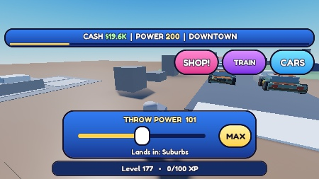
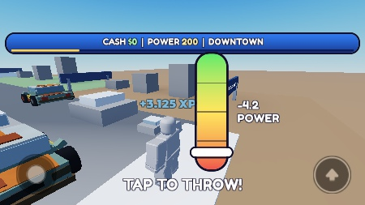
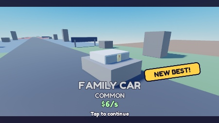
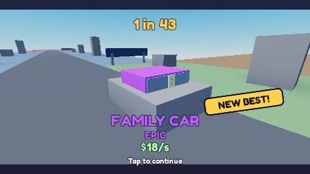
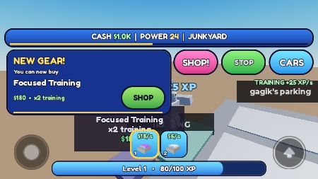
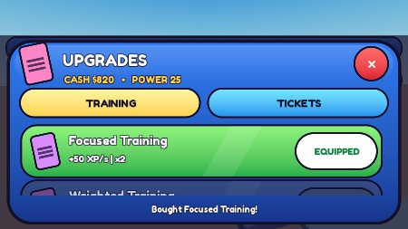
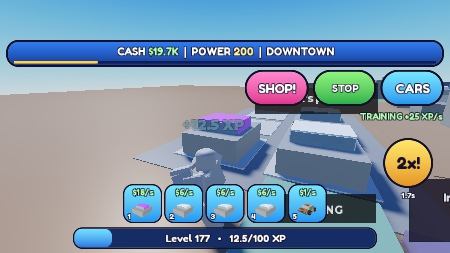
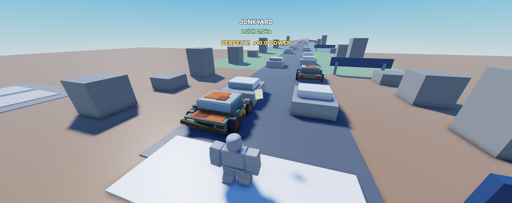
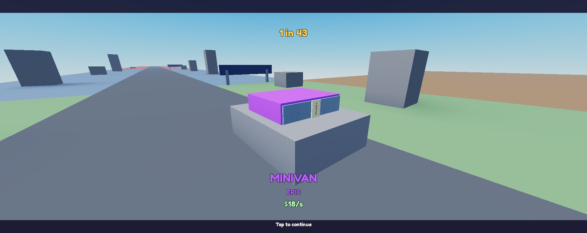
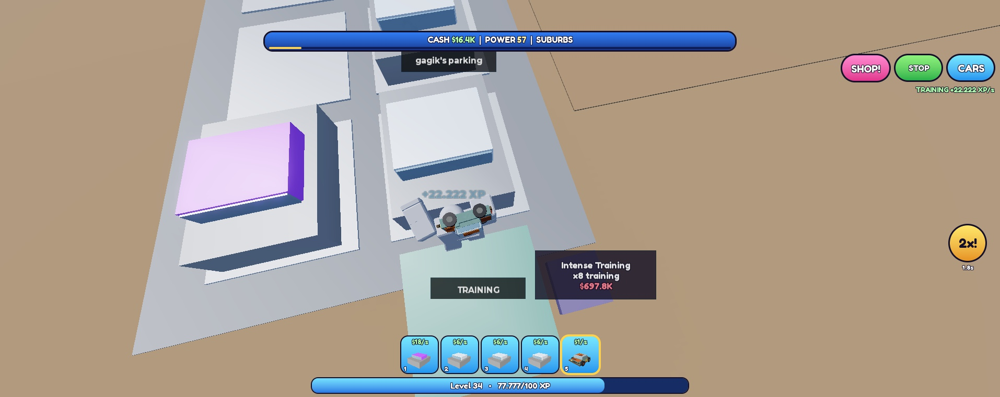
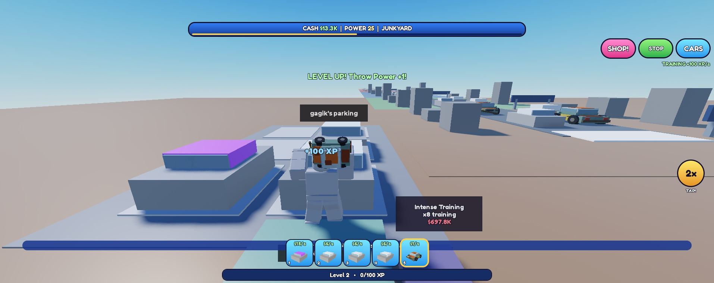

Dowody: [[games/ThrowTicketsAtCars/reports/2026-11-03_iteration10a_final_evidence.json]], [[games/ThrowTicketsAtCars/reports/2026-11-03_iteration10a_pc_evidence.json]], [[games/ThrowTicketsAtCars/reports/2026-11-03_iteration10a_audio_sources.json]].
