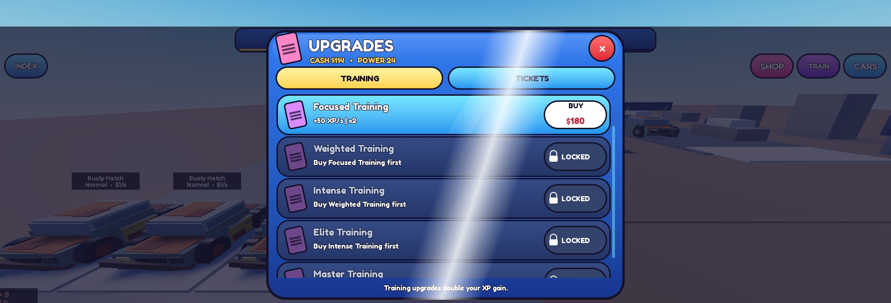
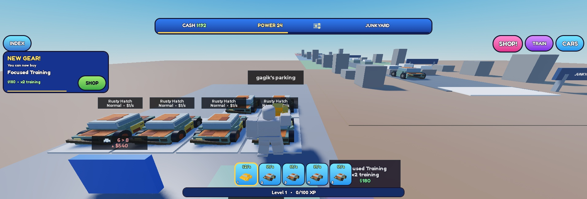

# Iteracja 10b po teście użytkownika · 03.11.2026
Wersja testowa. Wygląd i balans NOT FINAL. Źródło zasad: LihFolk Vault V2, tylko odczyt przez MCP. Testy Studio PC na izolowanym kluczu QA.

## Wyniki

- Migracja w Studio ze starego zapisu schema 5. Wczytano 26 aut, w tym 6 wcześniej BIG na parkingu oraz Gold GIANT w plecaku. Zwykłe auto testowe zarabiało po migracji $1/s, a Gold $2/s. Id, miejsca i odmiany zachowano.
- Przy 6/6 aut na parkingu i 20/20 w plecaku PLACE pokazało instrukcję ulepszenia lub zamiany. Przytrzymanie promptu Swap car przeniosło qa-7 do slotu 1 i qa-1 do plecaka. Liczniki zostały 6/6 oraz 20/20.
- Wymuszone Legendary Neon pokazało 149 zmian tekstu licznika w ok. 2,5 s. Próbki poniżej pokazują, jak przyrost zwalnia przed końcem. Format tysięcy potwierdzono na klatkach. Pierwszy tap domyka licznik i odsłanianie według kodu. Nagranie klatek dokumentuje pełny przebieg bez tapnięcia.
- Na zrzucie sklepu smuga jest w połowie przejazdu i przecina nagłówek, zawartość oraz ramkę.
- 381 asercji w 10 zestawach, w tym 10 000 deterministycznych losowań. W historii konsoli podczas sesji QA zarejestrowano wpisy błędnych poleceń inspekcji przy pierwszej próbie. Właściwy przebieg złapania i zamiany wykonano ponownie z poprawnymi ścieżkami.

| Czas | Licznik |
| --- | --- |
| 0 ms | 1 in 1 |
| 184 ms | 1 in 8,198 |
| 584 ms | 1 in 22,000 |
| 1 185 ms | 1 in 34,170 |
| 1 585 ms | 1 in 38,034 |
| 2 184 ms | 1 in 39,919 |
| 2 502 ms | 1 in 40,000 |

## Zrzuty ze Studio PC

[Przebieg licznika, klatka 1](10b-fixes-odds-1.jpg) · [klatka 2](10b-fixes-odds-2.jpg) · [klatka 3](10b-fixes-odds-3.jpg) · [klatka 4](10b-fixes-odds-4.jpg)

## Co sprawdzić

1. Na pełnym parkingu wybierz PLACE przy aucie z plecaka. Podejdź do zajętego miejsca i przytrzymaj Swap car.
2. Przy rzadkim złapaniu poczekaj na koniec licznika. Przy następnym złapaniu tapnij w trakcie, aby od razu zobaczyć wynik.
3. Otwórz sklep i poczekaj kilka sekund. Smuga powinna przejść przez całe okno.
4. W Studio, w trybie serwera z ustawionym izolowanym `ServerStorage.TestProfileKey`, wymuś następne złapanie poleceniem `game.ServerStorage.ThrowTicketsQA:Invoke("ForceNext", {Rarity = "Legendary", Variant = "Neon"})`.
