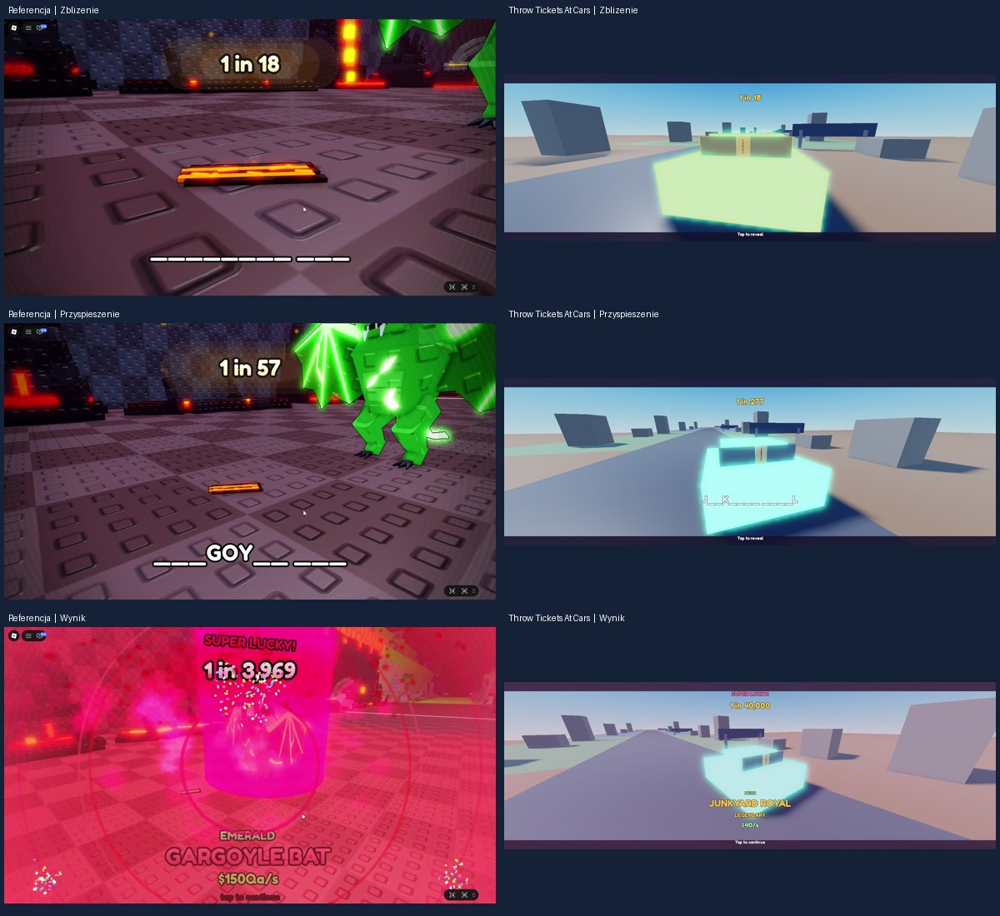
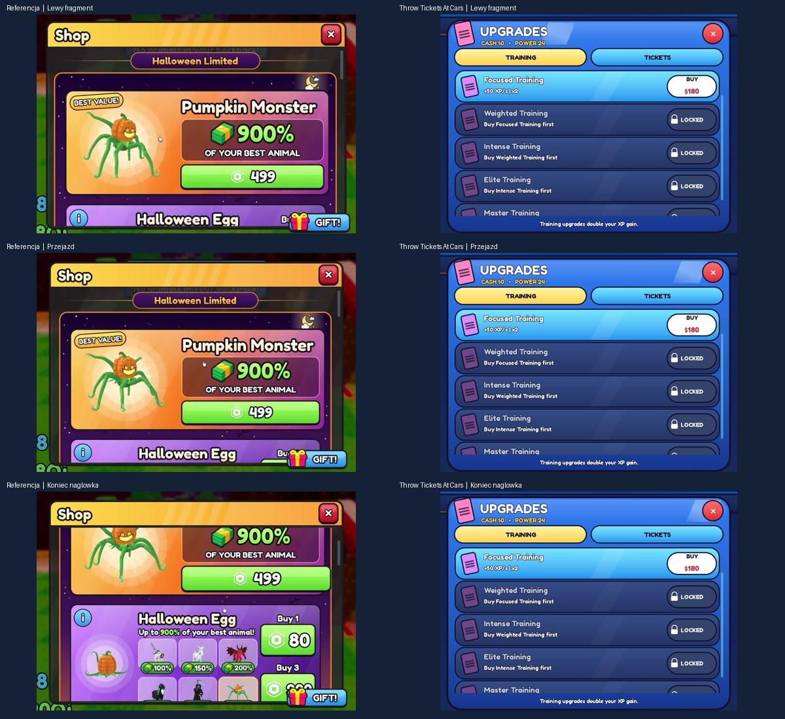

# Iteracja 10b, runda 2 · 03.11.2026

Wersja testowa. Referencje z nagrań użytkownika to złapanie z `16-59-21` i potwierdzone okno Shop z `17-08-54`. Załączony plik `17-00-35` przedstawia trening. LihFolk Vault V2, „Reward Moments and Celebrations”, odczyt przez MCP. Wynik i jego szanse ustala serwer przed animacją.

## Złapanie

- Próbkowanie obrazu co 0,1 s. Około 17,4 s licznik dochodzi do 18 i następuje cięcie. Widać zbliżenie na przedmiot, a od około 17,7 s kreski odpowiadające literom. Wynik pozostaje na 18 przez około 1,3 s. Następnie wartości rosną coraz szybciej, m.in. 27, 42, 100, 445, 1,312, 2,791, 3,859. To kolejne próbki narastającego licznika, bez stałych wielkich skoków lub odrębnego paska postępu.
- Około 20,5 s pojawia się LUCKY!, około 21,2 s SUPER LUCKY!, a około 21,4 s widoczne są końcowe 3,969, pełna nazwa i kolorowy błysk. W naszej scenie na początku widać mandat na szybie. Kamera wycofuje się po pauzie i pokazuje całe auto. Licznik używa zmierzonego kształtu krzywej, skalowanego do faktycznych szans. Akcenty tekstu wchodzą 3,1 i 3,8 s po zbliżeniu, finał po 4,0 s. Pierwszy tap domyka licznik, nazwę i ujęcie.
- Odtworzono tempo części od zbliżenia do finału. Wcześniejszy fragment lotu pozostaje pod dotychczasowym HUD-em. Użyto własnych odgłosów tyknięcia, progów i finału. Zgodności ścieżki dźwiękowej oraz efektów klatka w klatkę nie potwierdzono.

## Shop

- Klatki okna Shop pokazują ukośny refleks na kolorowym nagłówku. Na ramce i przewijanej liście nie widać wspólnego rozjaśnienia. Przewijanie, animacje grafik ofert i modal zakupowy przerywają odcinki, więc nie udało się wyznaczyć pewnego okresu ani dokładnej prędkości z filmu.
- W grze porusza się oddzielny, półprzezroczysty pasek o szerokości 9% nagłówka, z pochyleniem 22° od pionu i maksymalną kryjącością ok. 34%. Przejazd w prawo trwa 0,85 s, a starty dzieli 5 s. Parametry są przybliżeniem. Usunięto równoległe pulsowanie przycisków wewnątrz sklepu.

## Weryfikacja

- Studio PC, izolowany profil QA. Wymuszony Legendary Neon przeszedł od pauzy na 18 do 40,000. W pomiarze finał wypadł po 4,017 s. Zrobiono trzy porównania faz ujęcia. W osobnym złapaniu klik podczas pauzy od razu ustawił 40,000 i zostawił kartę otwartą. Konsola klienta i serwera bez błędów w tej próbie.
- iPhone 7 poziomo w emulatorze. Sklep otworzył się przyciskiem HUD, a refleks uruchomił się w obszarze nagłówka. Pełne złapanie sprawdzono na PC.
- Rojo zbudował projekt. Dziesięć istniejących zestawów reguł zaliczyło 381 asercji, w tym 10 000 losowań.

## Co sprawdzić

1. Przy rzadkim złapaniu obserwuj pauzę na zbliżeniu, przyspieszenie i wejście SUPER LUCKY! tuż przed końcem.
2. Przy następnym złapaniu kliknij podczas pauzy. Wynik i pełna nazwa powinny pojawić się od razu. Drugi klik kontynuuje.
3. Otwórz Shop i zostaw go na kilka sekund. Refleks ma przejechać w prawo po nagłówku, a przyciski ofert mają pozostać nieruchome.
