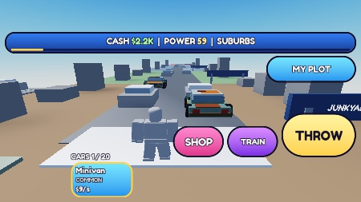
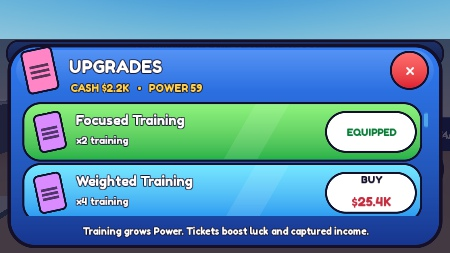

# Iteracja 7 — balans tempa
03.11.2026 · VERIFIED: symulacja i pierwsze minuty telefonu · **balans NOT FINAL**.

## Źródła i zastosowanie
LihFolk Vault V2 (CC BY 4.0), wyłącznie odczyt:
- [Progression and Pacing Design](</C:/Users/bruno/Documents/LihFolk/full/LihFolk Vault V2/LihFolk Vault V2/10 Game Design and Genres/Progression and Pacing Design.md>): TL;DR i sekcja 3.
- [Pricing Curves and Upgrade Costs](</C:/Users/bruno/Documents/LihFolk/full/LihFolk Vault V2/LihFolk Vault V2/48 Economy Design Deep Dive/Pricing Curves and Upgrade Costs.md>): TL;DR i sekcja 3 o payback.

MCP Obsidiana nie był udostępniony w tej sesji; odczytano te same notatki z lokalnego vaulta. W LihFolk niczego nie zapisano. Zastosowane reguły: dobór cen do czasu i dochodu, kontrola całej drabiny, osobne krzywe kosztu i korzyści, spadek czasu po ulepszeniu oraz payback = cena / dodatkowy dochód na minutę. Liczby poniżej są parametrami tej gry, nie uniwersalnymi zaleceniami LihFolk.

## Zmiana
- Istniejący SHOP obsługuje także brakujący zakup 5 kolejnych ćwiczeń. Każde podwaja szybkość ćwiczenia; startowe Basic Training jest darmowe. Bez nowych okien, modeli i mechanik poza wymaganym zakupem.
- Power rośnie tylko przez aktywny TRAIN. Rate = Work ćwiczenia / TrainingWorkPerPower biomu; koszty pracy: 4/18/32/90/220/220. Progi mapy pozostają 50/150/400/1000/2500.
- Ceny w Config mają Minutes i UnlockBiome. Price = round(Minutes × ReferenceIncomePerMinute biomu), wspólne dla serwera i UI.
- Referencja początkowa: 3 zwykłe auta × bazowy dochód, czyli $180/min. Później: 6 postawionych aut ze średnim mnożnikiem 3 oraz jedna sprzedaż co 45 s, z bazową średnią rzadkości 1,4 i mandatem referencyjnym biomu. To jawny benchmark do cen, nie obietnica konkretnego zarobku każdego gracza.
- Cena ćwiczeń w minutach: 0/1/2/8/25/90; mandatów: 0/1,5/6/15/40/120.
- Zarobek auta = floor(bazowy dochód biomu × rzadkość × mnożnik mandatu użytego przy złapaniu), minimum $1/s. Mnożniki mandatów: 1/1,5/2,2/3,2/4,6/12. Zaokrąglenie ma znaczenie dla najtańszych aut.
- Rzadkości zachowują wagi 70/22/7/1; ich mnożniki dochodu to 1/2/3/5. Luck nadal zwiększa tylko wagi Rare+. Mandat nigdy nie zwiększa zasięgu.
- Sprzedaż auta = 180 s jego dochodu. Tylko postawione auta generują dochód pasywny.
- Schema 3 zapisuje Exercise, ułamkowy Power i Ticket każdego auta. Migracja starych aut przypisuje Paper Ticket, zachowuje ID/slot/Cash/Power/mandaty. Zmiana wyposażenia nie zmienia wstecz bonusów aut.
- Poprawiono wyświetlanie ułamkowego Power i dużych cen; usunięto nieaktualne „+1/s” z tablicy treningu.

## Model symulacji
Moduł tests/BalanceSimulation.luau używa dokładnie produkcyjnych Rules, GarageRules i Config, bez kopii formuł nagród/cen/treningu. 30 deterministycznych seedów 104729 × i + 731, i=1..30. Fresh profile: Cash0, Power24, Basic Training, Paper Ticket. Bez Robux i dochodu offline.

Gracz najpierw zapełnia 6 miejsc, potem odświeża auto co 45 s i po wejściu do biomu robi 6 prób wymiany. Cykl złapanie→działka→postawienie/sprzedaż→powrót trwa umownie 14 s, zakup 2 s. W pozostałym czasie ćwiczy. Zawsze zachowuje najlepsze auta, słabsze sprzedaje. Kupuje dostępne, opłacalne ulepszenie według względnej korzyści na dolara; mandat dodatkowo musi mieć modelowy payback ≤120 min. Horyzont 120 min jest założeniem tego modelu. Payback mandatu zakłada odświeżenie aut do nowego typu nagród, a nie natychmiastowy bonus starego parkingu.

Czasy oznaczają sumę aktywnej gry; przerwy między sesjami nie dają postępu. To heurystyka aktywnego gracza, nie dowód optymalnej strategii.

## Wyniki — minuty od startu
Tolerancja ±25% liczona od środka przedziału celu: 75 s, 2,5/15/52,5/150/480 min. Sprawdzono każdy z 30 przebiegów, nie tylko medianę.

| Cel | Cel użytkownika | Mediana (min) | Min–max (min) | ±25% |
| --- | --- | ---: | ---: | --- |
| Pierwsze ćwiczenie | 60–90 s | 1,27 (76 s) | 1,02–1,52 (61–91 s) | PASS |
| Suburbs | 2–3 min | 2.73 | 2.73–2.73 | PASS |
| Downtown | 15 min | 17.08 | 16.58–17.33 | PASS |
| Sports Track | 45–60 min | 49.47 | 47.60–51.05 | PASS |
| Luxury Classics | 120–180 min | 150.32 | 147.07–154.03 | PASS |
| Hypercar Island | 360–600 min | 453.73 | 445.85–458.02 | PASS |

## Każdy zakup — reprezentatywny seed 2200040
Przebieg dobrano jako najbliższy medianom kamieni milowych i pierwszego zakupu; surowe dane zawierają wszystkie 30 przebiegów.

| Zakup | Minuta gry | Biom zakupu | Cena w min dochodu biomu odblokowania | Cena $ | Korzyść / payback |
| --- | ---: | --- | ---: | ---: | --- |
| Focused Training | 1.27 | Junkyard | 1 | $180 | czas ćwiczenia ×0,5 |
| Pink Slip | 1.72 | Junkyard | 1.5 | $270 | 6.28 min |
| Weighted Training | 7.23 | Suburbs | 2 | $25,488 | czas ćwiczenia ×0,5 |
| Parking Fine | 16.23 | Suburbs | 6 | $76,464 | 13.07 min |
| Intense Training | 30.22 | Downtown | 8 | $697,805 | czas ćwiczenia ×0,5 |
| Court Summons | 47.83 | Downtown | 15 | $1,308,384 | 31.88 min |
| Elite Training | 81.18 | Sports Track | 25 | $13,593,600 | czas ćwiczenia ×0,5 |
| Golden Ticket | 117.80 | Sports Track | 40 | $21,749,760 | 88.89 min |
| Master Training | 231.92 | Luxury Classics | 90 | $293,112,000 | czas ćwiczenia ×0,5 |
| Diamond Ticket | 334.22 | Luxury Classics | 120 | $390,816,000 | 73.58 min |

Dla ćwiczeń miarą korzyści jest czas potrzebny na ten sam przyrost Power: po każdym zakupie spada o 50%. Dla mandatów tabela pokazuje okres zwrotu dodatkowego modelowego dochodu; przedziały naturalnie kończą się na następnych odblokowaniach, zamiast nieskończonego wykupywania poziomów.

## Iterowanie liczb i wniosek
Pierwszy wariant miał zakup po 93 s oraz Suburbs po 194 s (seed731). Zmniejszenie benchmarku startowego 4→3 auta i kosztu pracy Junkyard 5→4 dało mediany 76 s i 164 s. Pozostałe biomy już mieściły się w tolerancji. Obliczenie payback wykazało zbyt słaby końcowy mandat; jego mnożnik dochodu zwiększono z6,5 do12, aby zwrot zmieścił się w przyjętych 120 min. Następnie wykonano końcowe 30 przebiegów.

Porównanie tego samego seeda731: Hypercar z ulepszeniami po 452.98 min, bez kupowania mandatów po 627.17 min — około 28% krócej dzięki mandatom, mimo niezmienionego zasięgu. Bez kupowania ćwiczeń model nie osiągnął Luxury/Hypercar w 24 aktywne godziny. Zakupy mają znaczenie, a skończona liczba poziomów i bramki biomów ograniczają kumulację.

Wniosek: cele czasowe są osiągnięte w tym modelu. Przebieg ma wzrost czasu kolejnych biomów i wyraźne skrócenie treningu po zakupach. Nie jest to jeszcze dowód, że długie oczekiwanie jest przyjemne.

## Telefon — rzeczywisty zegar
iPhone7, poziomo, viewport666×374, jeden gracz, osobny profil QA.
- Start: Cash0, Power24, puste auta, Basic Training/Paper Ticket.
- Skrypt tests/PhonePacing.client.luau klikał faktyczne GUI przez VirtualInput i chodził Humanoid:MoveTo. Bez przyznawania Cash/Power i bez teleportów QA.
- Pierwszy zakup Focused Training: **71,04 s**, cena $180.
- Pink Slip: **101,80 s**, zwykły BUY i EQUIP.
- Suburbs: **151,48 s (2:31)**. Oba cele telefonu spełnione.
- Pomiar od gotowego HUD i pierwszej akcji; przygotowanie automatyzacji było osobnym przebiegiem. Nakładka CaptureControls odrzucała środek THROW, więc helper klikał lewy fragment.
- Sześć pierwszych aut postawiono; kolejny łup sprzedano. Pełna symulacja późniejszej gry porównuje i zachowuje najlepsze auta.
- Po zakończeniu pomiaru sprawdzono odmowy: brak Cash, brak poprzedniego ćwiczenia i ponowny zakup.
- Po zakupie Pink złapano Minivan z Suburbs: $9/s = 6 ×1×1,5; dystans59,555… = Power, bez bonusu zasięgu.
- Save/rejoin zachował dokładnie 7 ID/typów/slotów/Ticket, ćwiczenie2, wyposażony Pink i ułamkowy Power59,555…; 6 aut postawionych, 1 w ekwipunku. Końcowe logi klienta i serwera bez błędów gry.

## Testy i komendy dev
- 112 asercji reguł/profili (34 nowe +62 pętla +9 profil +7 podstawy) oraz 512 kontroli akceptacji tempa: PASS.
- Komendy istnieją tylko w Studio, jako BindableFunction w ServerStorage; brak remote resetowania/przyznawania zasobów.
- Server Command Bar w Play: `game.ServerStorage.ThrowTicketsQA:Invoke("Reset")`, `:Invoke("AddCash",1000)`, `:Invoke("AddPower",5)`.
- Reset dotyczy aktywnego profilu; do QA ustaw ServerStorage.TestProfileKey w Edit przed Play. Test komend wykonano po pomiarze na profilu QA: Cash1000, Power29, puste auta, ćwiczenie1; NaN odrzucone.
- Z dodanym dopiero po pomiarze budżetem sprawdzono faktyczny BUY Weighted Training i odmowę duplikatu. Postępu użytkownika nie resetowano.

[Wyniki 30 symulacji](2026-11-03_iteration7_simulation.json) · [Pomiar, zapis i testy](2026-11-03_iteration7_evidence.json).

## Zakres weryfikacji i przekazanie
Późne 7,5 h jest wynikiem modelu, nie rozegraną sesją tej długości. Fizyczny telefon, wielu graczy, inne style gry i dłuższy test z ludźmi pozostają do wykonania. Użytkownik potwierdził 03.11 działanie pętli i zapisu iteracji6; nowy balans wymaga oceny.

Źródła w folderze/Rojo, pełna lokalna kopia assets/SavedStudio_2026-11-03.rbxlx. Studio Edit, emulator wyłączony, HTTP off, TestProfileKey usunięty. Bez publikacji i nowych modeli. **Balans NOT FINAL.**
