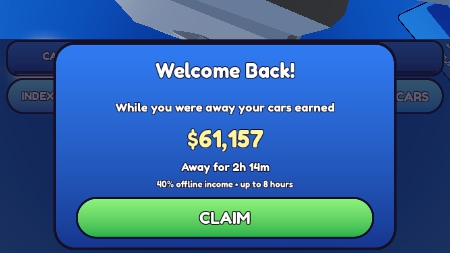
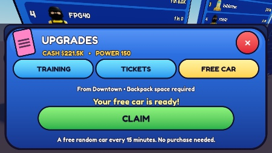
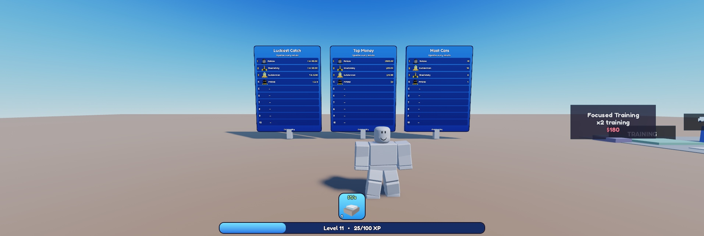

# Iteracja 10c — powroty i społeczność
05.11.2026. IMPLEMENTED; VERIFIED wyłącznie w opisanym zakresie. Wygląd i balans NOT FINAL. Kierunek próbki Welcome Back zaakceptowany przez użytkownika. Bez Rebirth, Robux i publikacji, wszystkie teksty gracza EN.

## Źródła i działanie
- Referencja: [[research/ThrowFoodForAnimals]] [G]. LihFolk Vault V2 (CC BY 4.0), przed kodem przez MCP Obsidiana, tylko odczyt: Offline Earnings; OrderedDataStores and Leaderboards; Retention and Return Hooks; Social Design and Multiplayer Play; Notification Queues and Limits; Testing Time-Based Features with a Controllable Clock; DataStore Fundamentals (budżety). Bez internetu i bez starych projektów.
- Config.Returns: offline 40%, 8 h, min 60 s; free 900 s; like 600 s. Schema 6 zachowuje bank, tutorial, terminy, czas gry i historyczny BestOdds.
- Serwer zapisuje znacznik wyjścia i dochód parkingu. Na load konsumuje nieobecność do pending i zapisuje przed DataReady; CLAIM zapisuje razem kasę i wyzerowany bank. Podczas zapisu nagrody inne mutacje czekają. Niepewne potwierdzenie nie robi rollbacku: sesja blokowana, reconnect odczytuje trwały stan.
- Nieodebrane środki przechodzą przez rejoin, łącznie najwyżej 8 h naliczania. Przerwa <60 s nie tworzy nowej nagrody; istniejący nieodebrany bank pozostaje dostępny. Dochód za każdą przerwę zaokrąglany w dół.
- FREE CAR: biom postępu z serwerowego Power, zwykłe losowanie auta/rarity/variant; Slot=0, kontrola 20 miejsc w plecaku, cooldown od skutecznego odbioru. Czas biegnie również offline, bez kumulowania nagród. Darmowy egzemplarz nie zalicza pierwszego catch ani rekordu szczęścia.
- Like odmierza rzeczywistą grę (offset QA nie przyspiesza), odracza w meter/catch i oknach; toast bez nagrody.

## Rankingi i przegląd bezpieczeństwa
- 3 tablice przy spawnie, top10, GetUserThumbnailAsync + cache nazw/avatarów. Most Cars = posiadane auta, Top Money = kasa, Luckiest Catch = historyczny rekord catch, także po sprzedaży.
- 3 listy/min, starty rozłożone co 20 s; zmienione wyniki co 120 s i przy wyjściu, kolejka scala wartości, maksymalnie 1 zapis/s. Kontrole OrderedRead/OrderedWrite/OrderedList, rezerwa 1; błąd zachowuje cache, bez cache ranking lokalny z jawnym podpisem.
- Przegląd wykrył wyścigi. Dodano testy oraz poprawki: inFlight zachowuje najnowszą wartość/generację, inicjalizacja nie wznawia się po wyjściu, rekord luck zapisuje max.
- Świadomy wyjątek od preferowanego w LihFolk SetAsync: UpdateAsync w indeksie pozwala atomowo odrzucić starszą generację sesji. Generacja rośnie przy przejęciu profilu i przetrwa zapis. Sprawdzane oba budżety; brak zapytań DataStore na wiersz.
- Indeks Cars/Money pakuje wynik i generację w integer <2^53. Cars i Money do $1M dokładnie; większe Money mają błąd <0,0003% i oznaczenie ≈. Kwota profilu pozostaje dokładna; bardzo bliskie wysokie wyniki mogą mieć remis w indeksie. Końcowy przegląd: bez dalszych uwag w sprawdzonym zakresie.

## Weryfikacja
- **470 asercji PASS**, 13 zestawów: 382 wcześniejszych (z nową kontrolą generacji), Returns 33, BoardIndex/Codec 43, transakcje CLAIM 12. W tym 10 000 deterministycznych losowań.
- Granice 59/60 s, 8 h/400 dni, cofnięty czas, brak tutorialu/parkingu, pending przez serializację, wielokrotny CLAIM, full backpack, cooldown/rejoin, zapis niepotwierdzony, budżet 0, throttle/backoff/cache, inFlight oraz stare sesje przy niższym/wyższym/identycznym score.
- Studio, tylko klucz QA_10c-20261105 i osobne indeksy STUDIO. Kilka prawdziwych stop/start bez zmiany profilu użytkownika. Zegar QA przesuwany wyłącznie na serwerze; lease zawsze używa realnego czasu.
- Po 8047 s nieobecności przy $19/s pending=$61 157, przed CLAIM kasa osobno. Rejoin bez odbioru + kolejna doba: łącznie 28 800 s, $218 879 (dwa zaokrąglenia). Podwójny klik oraz kolejne żądanie po 1 s wypłaciły tylko raz; rejoin <60 s nie odtworzył banku.
- Darmowy model Junkyard odebrany raz po podwójnym kliknięciu; przy Power150 następny pochodził z Downtown. Cooldown przetrwał rejoin. Przy 20 autach w plecaku odmowa zachowała gotowość i FreeAt.
- Pełny catch przełączył Tutorial=true i BestOdds=5. Przy PlaySeconds600 w fazie Meter LastLike=0; po zakończeniu catch LastLike=612. Osobno widoczny toast w Idle; kolejne progi sprawdzone testem reguł.
- 3 profile QA (UserId1/156/261) i gracz: prawdziwy odczyt OrderedDataStore, poprawne kolejności trzech rankingów, nazwy i avatary. Końcowy test dotyczył docelowego formatu indeksów v2.
- **Telefon pierwszy:** iPhone7 landscape, bezpieczny obszar 666×316. Welcome CLAIM436×56; Free CLAIM475×54, końcowy pomiar bez nakładania licznika. PC pomocniczo: sklep, countdown i 3 tablice. Fizyczny telefon i wiele jednoczesnych klientów: NEEDS VERIFICATION.
- Końcowe logi klienta/serwera: 0 MessageError. Pozostają wcześniej opisane ostrzeżenia wbudowanego pluginu/iniekcji i obcego assetu203785492; nie zmieniano pluginów.
- Rojo build PASS, 43 źródła zgodne ze Studio. Assistant HTTP allowlist blokuje lokalny endpoint — użyto źródeł z Rojo, przesłanych MCP i porównanych po normalizacji końców linii.
- Studio pozostawione Edit; emulator/HTTP off. Przywrócony wcześniejszy TestProfileKey=10b-my-test, ReturnQAOffset i pomocnicze atrybuty usunięte. Test awarii prawdziwego backendu/procesu nie był wykonywany; błędy zapisu i limitów wstrzyknięto do izolowanych testów.

## Co sprawdzić
1. Po prawidłowym złapaniu zaparkuj auto, wyjdź na ponad minutę i wróć: Welcome Back pokazuje kwotę/czas, kasa rośnie dopiero po CLAIM. Szybkie dwa kliknięcia nie podwajają wypłaty.
2. Odejdź przed CLAIM i wróć: bank zostaje. Łącznie nalicza się maksymalnie 8 h. Na profilu bez ukończonego pierwszego catch nie ma nowego zarobku offline.
3. W Shop otwórz FREE CAR: licznik, po gotowości czerwona kropka, odbiór losowego auta z aktualnego biomu. Po odbiorze ponownie 15 min; pełny plecak zachowuje gotową nagrodę.
4. Podejdź do tablic przy spawnie: sprawdź czytelność nazw/avatarów i wartości. Globalny ranking odświeża się co minutę, zapis nowego wyniku może czekać do 2 min.
5. Po około 10 min gry sprawdź mały toast like. Podczas złapania ma poczekać. Oceń wygląd i tempo na telefonie — techniczne PASS nie zatwierdza balansu.
