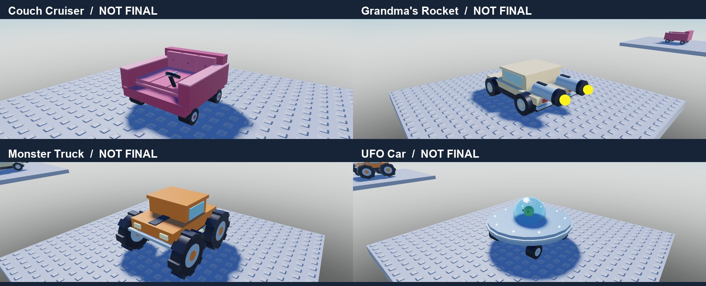
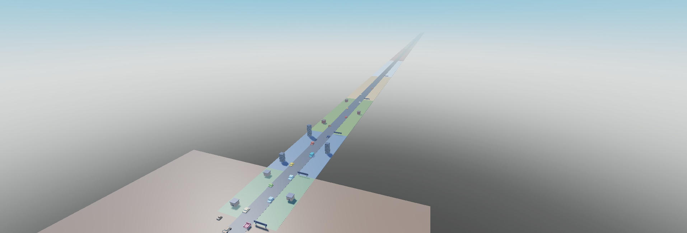
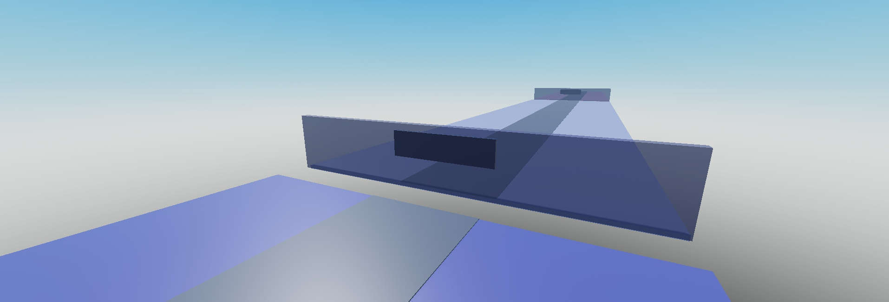
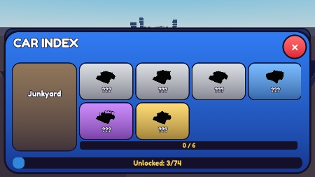

# Iteracja 11 — 10 biomów i 74 auta
05.11.2026. IMPLEMENTED; VERIFIED w opisanym zakresie. Lista i wygląd NOT FINAL. Użytkownik zaakceptował listę jako wersję roboczą, cztery próbki modeli czekają na ocenę. Pozostałe 70 modeli to prostsze bryły. Bez Rebirth, Robux i publikacji; teksty dla gracza EN.

## Źródła i zakres
- research/CarList_draft.md: wszystkie 74 nazwy i rzadkości, źródłowe opisy w CarCatalog.DraftDescription; angielskie Description do potencjalnego UI. Config.Biomes udostępnia cały katalog.
- LihFolk Vault V2 (CC BY 4.0), MCP Obsidiana przed implementacją, tylko odczyt: Progression and Pacing Design; Pricing Curves and Upgrade Costs; Genre Playbook – RNG and Collection Games; Parts Unions and MeshParts. Użyto blokoutu z części, wspólnych nazw/pivotów, cen w minutach, pomiaru pełnej drabiny i rzeczywistych wag RNG.
- LihFolk Asset Pack: Models/Kits/CATALOG.csv sprawdzony, brak pasujących pojazdów; bez importów i bez Dataset. Bez innych źródeł projektowych.
- 10 aktywnych biomów, droga do 6000 studów, segmenty ≤1000; różne kolory i po 3 grupy prostych rekwizytów rozłożonych na długości biomu. Moon Base i Candy Land za końcem aktywnej mapy, bariery i COMING SOON; 2 zablokowane sekcje Index bez kart aut.
- 11 ćwiczeń i 11 mandatów. Dotychczasowe Id sprzętu zachowane, kolejne dopisane. Ćwiczenie podwaja Work (Power/XP), mandat zmienia luck i dotychczasowy mnożnik dochodu, nigdy dystans.
- Schema7: stare biomy 1/2/3/4/5/6 → 1/2/3/7/8/9, Luxury Classics→Millionaire Hills. Każdy egzemplarz zachowuje Id, Slot, Ticket i Variant; model jest wybierany w tej samej rzadkości/semantycznym biomie. Dawne odkrycia mapowane, kilka starych modeli może wskazać jeden nowy, ale egzemplarze nie łączą się. Power, gotówka, sprzęt i Returns zachowane; dochód auta wynika z nowej ekonomii.
- Cztery staranniejsze próbki: Couch Cruiser, Grandma's Rocket, Monster Truck i UFO Car. Reszta ma rodziny brył, kolory i wybrane proste detale; pełne dopracowanie zgodnie z opisami dopiero po akceptacji próbek.
- Trafienie mandatu bierze faktyczny anchor z modelu; samochód zachowuje CarHeight=1.4. Sylwetki Index zachowują niewidoczne anchory, zamiast zmieniać je w czarne klocki.

## Ekonomia i symulacja
Cena = Minutes × ReferenceIncomePerMinute biomu odblokowania. Referencja zachowuje dotychczasową metodę: parking 6 aut z mnożnikiem rarity3 + sprzedaż co45 s, przypisany mandat referencyjny; starter 3 ekwiwalenty aut. Ceny i progi są wersją testową.
Trening: Work / TrainingWorkPerPower[biom]. Wejście do nowego biomu obniża rate, kupno następnego ćwiczenia podwaja je: np. Farm Roads 0.229→0.457 Power/s, Hypercar Island 0.142→0.284. To piłokształtny rytm; nie wprowadzono resetu postępu.

| Biom | Auta | Power | Dochód bazowy | Mediana czasu | Zakres 5 seedów |
| --- | ---: | ---: | ---: | ---: | --- |
| 1. Junkyard | 6 | 0 | $1/s | 0:00:00 | 0:00:00–0:00:00 |
| 2. Suburbs | 6 | 50 | $5/s | 0:02:44 | 0:02:44–0:02:44 |
| 3. Downtown | 7 | 150 | $22/s | 0:10:22 | 0:10:22–0:11:02 |
| 4. Farm Roads | 7 | 300 | $90/s | 0:21:58 | 0:21:48–0:23:06 |
| 5. Desert Highway | 8 | 550 | $360/s | 0:40:19 | 0:38:36–0:41:37 |
| 6. Snowy Pass | 8 | 900 | $1400/s | 1:09:18 | 1:05:52–1:10:30 |
| 7. Sports Track | 8 | 1400 | $5500/s | 1:41:58 | 1:38:30–1:43:27 |
| 8. Millionaire Hills | 8 | 2200 | $21000/s | 2:48:27 | 2:44:42–2:49:25 |
| 9. Hypercar Island | 8 | 3400 | $80000/s | 4:23:33 | 4:19:48–4:24:46 |
| 10. Future City | 8 | 5000 | $300000/s | 6:45:39 | 6:41:54–6:46:52 |

- Seedy1101–1105, świeży profil. Model używa rzeczywistych Rules.rollCar (rarity/model/variant), XP/level, cen, najkorzystniejszego dostępnego zakupu, 6 miejsc, wymiany gorszych aut i sprzedaży reszty. Stały dochód podczas czynności, trening tylko poza złapaniem/zakupem.
- Założenia: aktywna obsługa, catch14 s, kolejne odświeżenie parkingu co45 s, zakup2 s. Bez offline, free car, 2× boostu, ulepszania parkingu i ręcznych grantów. To symulacja, nie test wielogodzinny z człowiekiem.
- Wolniejszy wariant (seed1110, catch20 s / odświeżenie60 s): Suburbs3:26, Desert Highway43:29, Future City7:03:10. Pokazuje wrażliwość na obsługę; cel 2–3 min dotyczy podstawowego wariantu.
- Szczegółowe zakupy, przychody i czasy: [simulation JSON](2026-11-05_11_simulation.json).

## Weryfikacja
- **3560 asercji PASS:** 2771 katalog/migracje/geometria/anchor/wysokość +588 regresji+201 akceptacji tempa. Łącznie **40 000 deterministycznych losowań**: 10k w Junkyard z Diamond oraz po10k paper w Junkyard/Desert Highway/Future City.
- Wszystkie 48 starych CatalogId: zachowana tożsamość egzemplarza, slot, odmiana, mandat, biom i rarity; ponowna serializacja stabilna. Testy również wcześniejszych schema1–4. Każdy z74 modeli: bez kolizji/touch/query, ograniczona liczba części i rozmiar, anchor trafia w cel, dolna granica przy drodze.
- Zaktualizowano stare testy zakładające 6 biomów/8 aut, stare odds i usunięte LegacyCars; fixture historyczne pozostały jawnie starymi zapisami. Test pacing sprawdza nowe cele i 10 biomów, nie dawną drabinę.
- Studio: wyłącznie QA_11-20261105 i magazyn STUDIO. Fixture schema6 zapisany po zwolnieniu lease w serwerze QA (API Edit odmówiło zapisu). Po migracji qa-sports→Formula Rocket biom7 Gold slot1, qa-luxury→Chrome Classic biom8 Diamond slot2, qa-hyper→Infinity Hyper biom9 Neon plecak; BestOdds40000 i postęp zachowane.
- Save/stop/start: wszystkie trzy migrowane egzemplarze przetrwały. Rzut Power7000 zakończył się na dystansie6000 w biomie10, złapał UFO, a ono również przetrwało rejoin. Bez trafienia/auta w ComingSoon.
- Końcowy test wysokości w Reveal: Body.Y=1.4000001, anchor=(7,2.15,-6000). Klient i serwer 0 MessageError w tej próbie. Przegląd kodu wykrył i zamknął rozbieżność anchora oraz nieaktualny test tempa.
- Telefon: iPhone7 landscape, safe area666×316; Index74 kart/12 sekcji, Unlocked3/74 po migracji, dwie sekcje COMING SOON. PC: pomocniczy podgląd próbek i mapy. Fizyczny telefon, FPS na słabym urządzeniu i balans z graczem: NEEDS VERIFICATION.
- Rojo build PASS; 47 źródeł porównanych ze Studio po normalizacji końców linii. Galeria do zdjęć usunięta; mapa ma źródło w World/BiomeProps. Studio Edit, emulator/HTTP off, TestProfileKey i offset przywrócone do wcześniejszego nil.
- Wszystkie wyglądy NOT FINAL; PASS techniczny nie zatwierdza wyglądu ani balansu.

## Próbki do oceny

Pełne zrzuty: [Couch Cruiser](2026-11-05_11_couch.jpg), [Grandma's Rocket](2026-11-05_11_grandma.jpg), [Monster Truck](2026-11-05_11_monster.jpg), [UFO Car](2026-11-05_11_ufo.jpg).

## Co sprawdzić
1. Oceń cztery próbki: czy bryły i główne żarty są czytelne oraz czy ten kierunek pasuje do gry. Dalsze dopracowanie pozostałych70 jest zatrzymane do akceptacji.
2. Otwórz Index: 10 biomów/74 auta, zmienne liczby kart, odkryte modele w kolorze i pozostałe sylwetki; Moon Base/Candy Land wyłącznie jako COMING SOON.
3. Rzuć w kolejne biomy: sprawdź zmianę koloru/rekwizytów, ustawienie mandatu na nowym modelu i transport do parkingu. Najdalszy aktywny punkt to6000, przed zamkniętymi odcinkami.
4. Sprawdź posiadane auta po migracji: liczba egzemplarzy, odmiany i miejsca mają pozostać, nazwy/model i aktualny dochód mogą być nowe.
5. Na świeżym profilu oceń pierwsze3 min oraz przejście do Desert Highway. Wynik symulacji nie zastępuje Twojej oceny tempa i zabawy.
